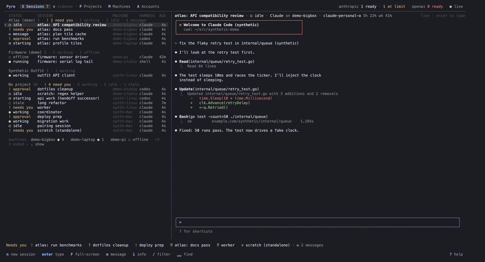
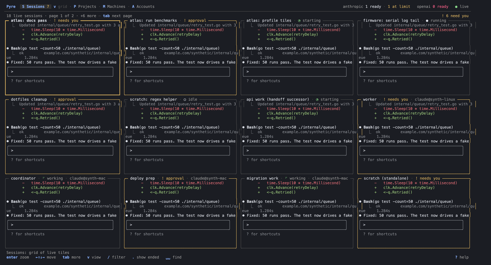
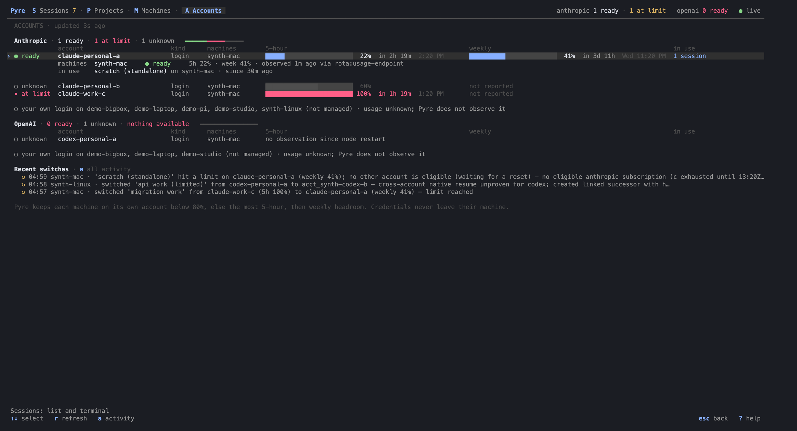
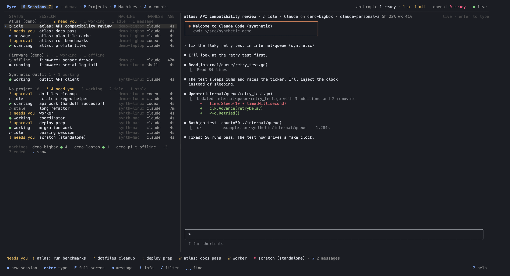

# Pyre

**One terminal UI for every Claude Code and Codex session on every machine you own, plus your phone.**



<sub>Recorded against Pyre's built-in synthetic fleet (`go run ./internal/tui/demo`); every name is made up.</sub>

Self-hosted: one hub, one daemon per machine, a CLI/TUI and an Android app. Your agents stay the native
`claude` and `codex` you already use, with their skills, plugins, subagents and settings. No orchestration
framework, no required workflow.

> **Status: pre-1.0 (v0.1.0 release candidates).** Used daily on a small fleet of Macs and Linux machines.
> Expect rough edges; see [what is tested](docs/acceptance.md).

## What makes Pyre different

### 🤝 Your agents work as a team — across machines
Any session can **start another session on any machine**, message it, wait for its answer, and gets an
**automatic report back** when the helper finishes, needs input or fails. Ask one agent:

> "Have Codex review this PR on the desktop and run the full test suite in Claude on the server, then merge
> what they find."

It spins up both, they work in parallel on their own machines, report back, and the coordinator carries on —
while you watch all three live in one list. Agents can rename, group (projects) and flag each other, share
notes and documents, and search what any other agent did. Messages are durable with explicit delivery states,
so nothing is silently lost or replayed.

### ♾️ Subscription limits stop being your problem
Add every Claude account once (`claude setup-token`) and it works on **every machine at the same time**.
When a session hits a limit Pyre **switches it to the account with the most headroom and resumes** — each
machine keeps to its own account where it can, so they don't pile onto one. Codex uses each machine's own
login. Every switch is in the audit log; credentials are never copied between machines.

### 🖥️ One cockpit for everything
Every Claude Code and Codex session on every machine, **live and typeable** in one TUI: ⌥↑/⌥↓ to jump between
them even mid-sentence, ⌥s to fuzzy-find, a grid of live tiles, a table with each session's account and usage,
and a "doing now" line ("running tests", "editing api.ts") for every working agent. Sessions that need you
float to the top — nothing else interrupts you.

### 🌙 Built to run unattended
Permission bypass for agents you trust, folder-trust prompts and exit dialogs answered for you, approvals
answerable from your phone, and agents that keep going through account limits. Close Pyre — every session keeps
running.

### 🔎 Total recall
Search every transcript on every machine at once, catch up with "while you were away", and see what each
machine and session is costing in CPU and memory.

## Features

- **Sessions:** live embedded terminal next to a list grouped by project; `F` attaches full-screen.
- **Attention first:** a *Needs you* bar; `⌥→` jumps to the next waiting session, `a` answers in place.
- **Fast switching:** `⌥↑`/`⌥↓` step through sessions even while typing, `⌥s` opens a fuzzy switcher.
- **Three views:** sidenav + terminal, a table with account and usage columns, a grid of live tiles (`v`).
- **Launch by repo name:** `n` → `repo [@machine] [claude|codex|agy|shell] prompt`; `ctrl+f` for a fresh worktree.
- **Account pool:** `claude setup-token` accounts usable on every machine, per-machine Codex logins, usage
  bars, automatic switching at limits (never silently to another provider or a paid API key).
- **Agent messaging:** durable messages with explicit delivery states; peers report back when they finish.
- **MCP tools:** every session gets the `pyre` MCP server ([agent tools](agents/tools/README.md)).
- **Search and digest:** search every transcript on every machine (`␣/`); "while you were away" (`␣w`).
- **Projects (optional):** briefs, versioned documents, artifacts and review comments.
- **Audit log and resource stats:** what Pyre did on its own; CPU and memory per machine and session.
- **Android app:** inbox, approvals, transcripts, messaging, launching and a real terminal ([android](android/README.md)).
- **Scriptable and signed:** `--json` everywhere; deterministic, signed release tarballs with SBOMs.

| Grid of live sessions | Accounts and automatic switches |
|---|---|
|  |  |



## What's included

Each piece is optional and works on its own; Pyre uses the others when they are installed.

- **Pyre**: hub, per-machine daemon, CLI/TUI and Android app (`cmd/`, `internal/`, `android/`).
- **[Hive](tools/hive/README.md)**: shared session memory, workstreams and worktrees for Claude Code and Codex, synced across machines.
- **[Outfit](tools/outfit/README.md)**: local connector runtime giving agents one CLI/MCP way to use GitHub, Slack, Linear, Notion, Sentry, Stripe and more, with credentials in the OS keychain.
- **[Rota](tools/rota/README.md)**: Claude account switcher with Claude and Codex subscription usage bars.

Releases ship the three tools as a separate `pyre-tools-<version>-<os>-<arch>.tar.gz`; `install.sh --with-tools`
installs them next to Pyre and skips any tool you already have installed (`make tools` builds them from source).
Windows gets Outfit only (`pyre-tools-<version>-windows-<arch>.zip`, `outfit.exe` and `outfit-core.exe`) through
`install.ps1 -WithTools`.

## Quick start

Try the TUI with no setup (synthetic fleet, no network; needs Go 1.27+, `q` quits):

```sh
git clone https://github.com/jhh3/pyre && cd pyre
go run ./internal/tui/demo
```

For real use you need Go 1.27+ and `make` to build, and `tmux` plus the `claude` and/or `codex` CLI on each
machine that runs agents (Google Antigravity's `agy` is offered too wherever it is installed and signed in). One machine runs both the hub and a node. Each step is explained in
[getting started](docs/getting-started.md). The steps below install per-user services (launchd/systemd
`--user`); to try Pyre first with everything in the foreground and no account, follow
[try it without services](docs/getting-started.md#try-it-without-services).

1. **Build and start the hub**

   ```sh
   make build
   export PATH="$HOME/.local/bin:$PATH"          # also add this to your shell rc
   HUB=https://my-desktop.local:7443            # reachable by your other machines and phone
   bin/pyre-hub init --data ~/.local/share/pyre-hub --hub-url $HUB --tls-host my-desktop.local --tls-host 127.0.0.1
   scripts/install/install.sh --from bin --allow-unsigned \
     --service hub --hub-data ~/.local/share/pyre-hub --hub-url $HUB
   ```

2. **Log in the CLI** (the credential file `init` wrote carries the hub URL and TLS fingerprint)

   ```sh
   pyre login --token - < ~/.local/share/pyre-hub/owner-credential.json
   pyre hello
   ```

3. **Make this machine a node** (`pyred enroll` reads the secret: paste it and press enter)

   ```sh
   pyre enroll-node --name desktop              # prints a one-time secret and the next command
   pyred enroll --hub $HUB --pin <fingerprint> --node-id <node_id> --secret-stdin
   scripts/install/install.sh --from bin --allow-unsigned --service node --name desktop
   pyre nodes
   ```

4. **Add another machine** over an ssh alias you already use

   ```sh
   pyre enroll-node --name laptop --ssh laptop --bootstrap            # dry run
   pyre enroll-node --name laptop --ssh laptop --bootstrap --execute
   ```

5. **Pair your phone** (build the app first, see [android](android/README.md))

   ```sh
   pyre pair-client --name phone --kind android     # open the pyre://pair link on the phone
   ```

6. **Add a Claude account**

   ```sh
   claude setup-token | tail -1 | pyre accounts add-token personal --provider anthropic
   ```

7. **Start a session**

   ```sh
   pyre new myrepo "add a --verbose flag and tests"     # Claude by default; add codex or shell
   pyre                                                 # open the TUI
   ```

## Adding repos and folders

Pyre finds your git repos by itself — no registration step — and any repo works on any machine.

- **Where it looks:** each machine scans `~/code`, `~/src`, `~/Documents/code` and `~/projects` (4 levels deep,
  metadata only, 20 seconds after the node starts and then every 10 minutes). Clone a repo into one of those
  and it shows up in the new-session panel and `pyre repos` after the next scan — or right away with
  `pyre repos --rescan` (every connected machine; `--node <machine>` for one). A path works right away too.
- **Your GitHub repos:** a machine where the `gh` CLI is logged in lists your GitHub repositories (yours,
  collaborator and organization ones, plus repos you recently committed or opened PRs to) every hour and
  reports them to the hub. Pyre uses gh's own login and stores no token; `pyred run --no-github-catalog` turns
  it off. The new-session panel ranks: used in Pyre recently, then contributed to on GitHub recently, then
  checked out on a machine, then the rest — one entry per repository, however many machines have it.
- **Any repo on any machine:** pick a machine that does not have the repo and it is cloned there first, with
  that machine's own git credentials (ssh key, credential helper or gh), into its repo root laid out like the
  repos already there (`~/code/<name>` or `~/code/<owner>/<name>`). An existing directory is never overwritten;
  a different repo at that path is refused with a message. From a shell: `pyre new acme/atlas @laptop` (a line
  on stderr says it clones; `--no-clone` refuses instead).
- **Use other folders:** start the node with `pyred run --repo-roots ~/work,~/oss` (or set
  `PYRE_REPO_ROOTS=~/work,~/oss`); `--no-repo-index` turns scanning off.
- **Start in a repo:** press `n`, type part of its name (`atlas`) or `owner/name`, and adjust the fields below
  it — Machine, Agent (Claude/Codex/Agy/Shell), Workspace (main checkout, fresh worktree or a new branch), Account,
  Model, Effort, Prompt, Title — with ←/→ or a click; `ctrl+s` (or `ctrl+enter`) starts. `+` adds another repo to the same
  workspace. Machine, agent and workspace are remembered per repo. From a shell:
  `pyre new atlas @desktop codex "fix the flaky test"`.
- **Start anywhere else:** type a path instead of a repo — `~/scratch`, `/tmp/experiment` — and Tab completes
  folder names on the chosen machine; a missing folder is offered as "create". `pyre new ~/scratch --mkdir`
  does the same from a shell, and `~` alone starts a scratch session in your home folder.
- **Group work (optional):** `pyre project new <name> --repo id=url` gives related sessions a shared brief and
  documents; agents can create projects and move themselves into them too.

## Everyday keys

| Key | Action |
|---|---|
| `enter` / `ctrl+]` | type into the session / leave it |
| `⌥↑` `⌥↓` / `⌥s` | previous, next session / quick switcher |
| `⌥→` / `a` | next session that needs you / answer its approval |
| `n` | new session |
| `v` | cycle views: sidenav → table → grid |
| `1` `2` `3` `4` | Sessions, Projects, Machines, Accounts |
| `?` / `q` | every key / quit (sessions keep running) |

`pyre keys` prints the full map. On a Mac, set Option to send Meta for the `⌥` keys
([details](docs/getting-started.md#troubleshooting)).

## Configuration

- CLI config: `~/.config/pyre/client.json`; key overrides: `~/.config/pyre/keys.toml`.
- Node options go through the installer: `install.sh … --service node --pyred-arg --trust-dir --pyred-arg ~/code`.
- Useful `pyred` flags: `--trust-dir`, `--permissions ask|bypass`, `--repo-roots`, `--max-runs`.

Full reference: [configuration](docs/configuration.md). Upgrade, rollback, backup and uninstall:
[operations runbook](docs/operations.md).

## How it works

```text
 phone app ──┐                 ┌── pyred · laptop  ─ private tmux ─ claude · codex · shell
 pyre TUI  ──┼── pyre-hub ─────┼── pyred · desktop ─ private tmux ─ …
 pyre CLI  ──┘   (HTTPS,       └── pyred · server  ─ private tmux ─ …
                  pinned TLS)
```

Nodes dial out to the hub over one pinned HTTPS port, so nothing needs to reach into your machines.
Details: [architecture](docs/architecture.md).

## Security

- Secrets are read from stdin or the keychain, never from a command line.
- Each device has its own revocable credential; account tokens are encrypted at rest on the hub.
- Credentials are never copied between machines, and your own `~/.claude`, `~/.codex` and tmux are untouched.
- Releases are signed; the installer refuses tampered or foreign-signed tarballs.

More: [configuration → security model](docs/configuration.md#security-model) and [SECURITY.md](SECURITY.md).

## FAQ

**Does Pyre change how Claude Code or Codex behave?**
No. They run as the native CLIs in real terminals, with your skills, plugins, subagents and settings.

**A new session waits at "Do you trust this folder?"**
Install the node with `--pyred-arg --trust-dir --pyred-arg <dir>`, or press `enter` in its terminal once.

**Agents stop for permission prompts while I'm away.**
Answer from the TUI (`a`) or the phone. Where you accept the risk, use `--permissions bypass`.

**Do I need projects?**
No. Projects are an optional way to share a brief, documents and artifacts between sessions.

**A node shows `disconnected`.**
Run `pyred status` on it. More fixes: [troubleshooting](docs/getting-started.md#troubleshooting).

## Documentation

[Getting started](docs/getting-started.md) · [Configuration](docs/configuration.md) ·
[Operations](docs/operations.md) · [Architecture](docs/architecture.md) ·
[Agent tools](agents/tools/README.md) · [Android](android/README.md) · [Packaging](packaging/README.md) ·
[Capabilities](docs/capabilities.md) · [Integrations](docs/integrations.md) ·
[Product spec](docs/product-spec.md) · [Acceptance](docs/acceptance.md)

## Contributing

Bug reports and pull requests are welcome; see [CONTRIBUTING.md](CONTRIBUTING.md) and the
[code of conduct](CODE_OF_CONDUCT.md). Report security issues privately as described in
[SECURITY.md](SECURITY.md).

## License

[MIT](LICENSE). Third-party notices are in [NOTICE](NOTICE).
