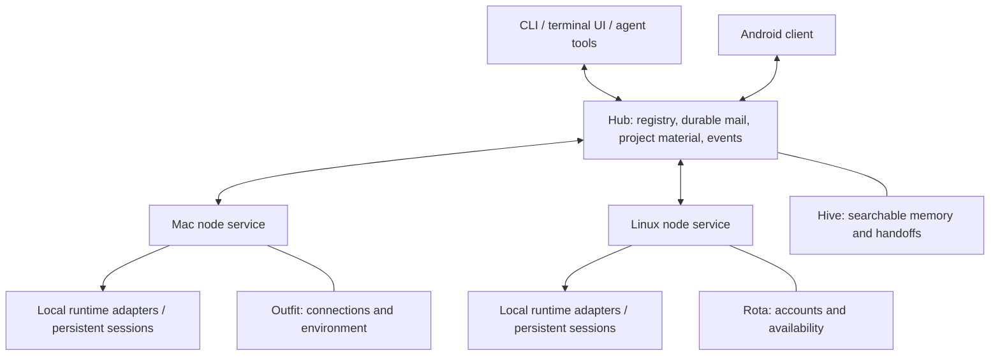

# Architecture

Status: proposed implementation architecture. Nothing in this document means the system has been built or that a third-party integration has been verified. Product requirements are defined in [product-spec.md](product-spec.md); interface semantics are in [contracts.md](contracts.md).

## 1. The shape of the system

Pyre connects existing agent runtimes and the user's machines. It supplies durable communication, shared material, environment management, and useful interfaces. It does not prescribe an agent hierarchy, require every session to enter a project, or make agents use a task engine.

Use one small shared hub on an existing always-on machine, one node service on each participating Mac/Linux machine, and clients for terminals and Android. The hub can also run on a node. Prefer ordinary local storage and existing network access over new managed infrastructure.

This is a logical boundary diagram, not a microservice mandate. Package the hub as one managed service bundle; a reused HAPI backend may require a supervised helper process alongside the Go facade. Document every process and its lifecycle rather than pretending that different runtimes form one binary. Hive, Outfit, and Rota may remain separate commands behind adapters where that is simpler. Do not create a broker, orchestration cluster, consensus layer, or service mesh for the first release. [R01–R14]

## 2. Backend choice is a gate

HAPI is the first backend candidate because its public project describes remote agent access, machine runners, session control, and mobile clients. These are research leads, not accepted Pyre guarantees. The [research notes](research.md) must record pinned source revisions and observed behavior.

Before committing the implementation to HAPI, build a small vertical spike that proves:

1. A Mac and a Linux host can register, reconnect, and launch both supported harnesses.
2. A human can join the actual managed session through the terminal and return to remote control without losing the thread or duplicating execution.
3. A busy and an idle session can receive addressed messages through supported interfaces, including answers to pending questions or approvals where the harness allows them.
4. Native subagents still work; wrapping the harness does not disable or replace them.
5. The session can use an isolated account identity without mutating another active session's authentication.
6. The node can recover its control connection without killing a healthy runtime.
7. An upstream Android client or a minimal mobile API probe can inspect, reply, and perform an approval through the authenticated path. This is a bounded backend-compatibility spike; the finished Pyre Android client belongs to WP16/G3 and must not block the backend decision.

Record these results per harness and per platform, including unsupported behavior. HAPI may pass for one harness and need a direct adapter for another. If supporting the contracts requires pervasive upstream changes, implement a direct adapter for that harness. Prefer upstream contributions or narrow maintained extensions over a deep fork. License compatibility and derivative obligations must be checked before copying code or shipping a fork.

WP00 publishes a versioned provisional schema and fixtures immediately so independent workers can start. G0 then validates or amends the backend boundary, provider capability contracts, runtime versions, and deployment package in an architecture decision record. UI, fixtures, project storage, and research can proceed in parallel against those shared provisional contracts. Production session transport cannot be considered done against mocks alone. [R02, R04, R08, R12, R13]

## 3. Who owns what

| Data or capability | Authoritative owner | Local/offline behavior |
|---|---|---|
| Running process, PTY, working directory, execution state | Executing node and runtime adapter | Continues without the hub; inspect and attach locally |
| Fleet registry and last reported status | Hub, from node reports | Cached elsewhere with a timestamp and disconnected indicator |
| Shared message record and routing receipt | Hub after durable commit | Origin node/client holds a durable outbox until accepted |
| Recipient delivery attempts and runtime acceptance evidence | Recipient node | Persist locally and reconcile with hub |
| Project metadata, document revisions, review comments | Hub | Cached reads; offline edits remain proposals until revision validation |
| Published artifact versions and manifest | Hub file store | Verified local caches; unfinished uploads are not published |
| Working code and unsubmitted files | Their actual checkout on a node | Git, worktrees, or an explicit sync action move code |
| Searchable memory and provenance | Hive according to its integration contract | Existing local capture/search survives hub loss |
| Session account binding and credential handles | Executing node/Rota adapter | Binding stays fixed for a run; conservative behavior with stale availability |
| Provider availability observations | Reporting node; aggregated by hub | Show source, observation time, confidence, and reset hint |
| Desired tool/configuration versions | Outfit-managed profile recorded by hub | Node retains last applied generation; reports drift |

Do not maintain two independent authoritative copies of the same logical record in HAPI and Pyre. Reuse a backend store or add a sidecar store behind a clearly assigned owner. Events and indexes may be replicated; ownership must remain explicit. [R04–R11, R14]

## 4. Connectivity and enrollment

Use existing SSH aliases and Twingate for discovery, bootstrap, administration, and emergency access. Do not require Tailscale. Start with an explicit host list; automatic LAN discovery is optional later.

A bootstrap command verifies the SSH host identity, installs the node service with the user's existing permissions, and enrolls the machine with the hub. Enrollment gives it a stable node ID and a revocable credential. A node reconnects outward to the hub using an authenticated encrypted connection. This avoids a full mesh of node connections and avoids requiring every laptop to expose an inbound application port.

The hub exposes HTTPS for CLI and Android clients; a WebSocket or equivalent bidirectional stream carries events and node commands. Exact transport and certificate provisioning are spike decisions. Twingate supplies network reachability; application authentication still distinguishes the owner, enrolled nodes, and session-scoped agent credentials. No public unauthenticated endpoint is needed.

Clients may use a local Unix socket to reach the same machine's node service when the hub is unavailable. A remote terminal attachment may use the existing SSH route or a backend relay depending on adapter support. An attach descriptor advertises the supported mechanism rather than assuming all clients support a terminal tunnel.

One hub is sufficient initially. Back it up and test restoring it. A VPS is an optional placement for the same service if the existing host is too intermittent. Multiple writable hubs are out of scope. [R01, R12–R14]

## 5. Sessions, runs, and human interaction

A **session** is a durable conversation/work identity. A **run** is one execution of that session on one node with a specific runtime version, directory, environment generation, and account binding. A process restart or account fallback creates a new run while preserving lineage. Migration to another machine is an explicit operation; ordinary attachment never moves execution.

A node wraps the actual Claude/Codex process through a runtime adapter. Prefer structured APIs for messages, events, approvals, and status when they are available and compatible with terminal use. Use a persistent PTY/tmux where appropriate for attachment and execution survival. A PTY alone cannot establish that the agent received a prompt or that it completed a task.

The backend spike must decide the exact ownership relationship between a harness process, its terminal UI, and any app-server/SDK connection. Do not assume that launching an independent native client attaches to the same execution. A restartable controller must not inadvertently terminate child runtimes; the process supervisor and reconnect strategy are part of the proof.

Human clients and agent clients use the same session actions. Conflicting raw terminal input uses a visible input lease; transcript viewers do not need one. Leaving a native terminal attached must not prevent peer coordination: supported structured input and inbox polling continue, respecting the adapter's busy/turn semantics. Raw input that would collide queues and remains visible. Steering or takeover is a distinct explicit action with a traceable actor. Structured approvals carry a request ID and run ID so that an answer cannot land in an unrelated new prompt. Avoid unattended keystroke injection into an unknown prompt.

Native subagents belong to the harness. Preserve their behavior and expose observations only where the harness supports them. Fleet sessions are separately addressable workers; creating one does not require changing or mirroring the harness's internal subagent tree. [R02, R03, R12]

## 6. Orchestration without a required orchestrator

Expose discoverable tools for machines, sessions, messages, projects, memory, artifacts, connections, and account availability. A user can ask any agent to coordinate other sessions. The agent can launch workers, exchange messages, inspect results, and leave handoffs using those tools.

Persist the effects of these actions, their actors, and their resulting references. Do not require plans, roles, task boards, or project membership before actions work. Optional project checklists and saved automation recipes can be built over the primitives later; they are not prerequisites for messaging or launching work.

Provide short working guidance: look for existing relevant work; communicate intent when sharing a checkout; publish durable decisions; include pointers in handoffs; distinguish uncertain delivery from failed delivery; request help when needed. Keep the guide concise and editable. Do not repeatedly inject a long mandatory orchestration prompt into every turn. [R03, R05, R07]

## 7. Durable messages

Messages are addressed to stable session IDs, with optional thread and project references. A project's activity feed can aggregate linked messages without making every session consume a broadcast transcript. Direct messages are the first delivery primitive; channel subscription can be additive.

The delivery path is origin outbox → hub inbox record → recipient node inbox → supported runtime input. Each hop commits before acknowledging the preceding durable hop. A stable message ID prevents creating another logical message on retries. Once delivery is attempted against a run, retain that run binding and its evidence.

There are distinct facts:

- **Stored:** the hub has durably accepted the message.
- **Runtime accepted:** the recipient adapter has evidence that this run's supported input interface accepted it.
- **Acknowledged:** the recipient explicitly acknowledges or replies; this may be optional.
- **Completed:** an explicitly reported work outcome, never inferred from transport delivery.

If a runtime accepts input and the node crashes before persisting the receipt, the delivery is **indeterminate** unless the runtime can reconcile by an idempotency key or event ID. Show that state, inspect runtime evidence, and ask the coordinating actor to resolve it when necessary. Do not blindly replay a potentially side-effecting instruction. At-least-once transport and deduplicated inbox storage do not create exactly-once agent actions.

Offline recipients retain queued messages. Restarted nodes reconcile their durable inboxes with hub cursors. Replaced runs do not automatically execute messages that may already have been consumed by the prior run. Retrying a clearly unattempted message is safe; reissuing uncertain work is a new explicit action referencing the original message. [R04, R14]

## 8. Projects, documents, artifacts, and memory

Projects are optional containers with a name, brief, linked repositories/checkouts, documentation, artifacts, review threads, and related sessions. A project can exist without a Git repository. A session may join later or remain standalone indefinitely.

Project documents use explicit immutable revisions and compare-and-swap updates. A local editor integration checks out a revision, opens it normally, then submits a proposed successor. Concurrent changes return a conflict and preserve both proposals; do not silently apply last-writer-wins to plans or decisions. The first implementation does not need real-time collaborative text editing.

Publishing an artifact copies bytes into hub-managed shared storage, verifies their digest, and commits its manifest only after upload completion. Versions are immutable and have stable references, media type, original filename, author, and provenance. Review comments attach to a document revision or artifact version. A producing laptop may sleep after publication without breaking access. Large files require explicit bounds and resumable uploads where needed; a remote filesystem path is not a published artifact.

Working code is not automatically shared storage. Project bindings record node/repository/path/branch or worktree associations. Shared checkouts are allowed, but users/agents choose whether to use a shared directory or isolated worktrees. Advisory file reservations can be explored without turning them into mandatory task locks.

Hive captures and retrieves memory: transcripts, notes, decisions, handoffs, and links back to evidence. Project documents are the canonical user-reviewable statement of current intent; Hive indexes them instead of becoming a competing mutable copy. Notes can be promoted to a document with provenance. Launch context includes the concise current brief and selected pointers, not the entire project history.

Retain existing Hive synchronization during migration until replacement behavior is demonstrated. Explicit handoffs should reach the shared system promptly; transcript enrichment may be asynchronous and must show freshness. [R05–R07]

## 9. Accounts and environment management

Rota chooses among the user's configured subscriptions for the requested provider. Bind the chosen account to a run before launching it. Different concurrent runs must be able to use different identities without switching shared global login state. The implementation must verify provider-specific mechanisms for separate configuration homes, environment variables, credential stores, and refresh behavior on macOS and Linux.

Represent a subscription/account separately from its credential instances. Prefer independent supported device logins per machine. If a rotating credential must be shared, one refresh owner or a proven serialization mechanism governs it; copying files among active processes is not an adequate protocol. Coordination must reject stale owners/generations. During a hub partition, a node may use a valid existing credential but cannot assume ownership of a shared refresh operation. Never store credential bytes in session records, memory, artifacts, event logs, or Git.

Aggregate available provider usage signals with timestamps and confidence. Admission checks can consider observed usage, cooldown, and active assignments. These are estimates, not reservations against an authoritative provider quota. Stale data cannot promise remaining capacity. Account exhaustion should preserve work and expose a clear waiting state.

Fallback remains within the same provider. Checkpoint or reconcile the interrupted run, select another eligible configured account, and resume only through a verified adapter capability. Keep the old run immutable for audit. If continuation is unsupported, preserve a handoff and mark the need for intervention; do not invent a successful seamless resume. Notify when all eligible accounts are unavailable. Retrying a provider request whose execution outcome is uncertain follows the same no-blind-replay rule as messaging.

Outfit resolves named connections, machine/project grants, skill and plugin bundles, and configuration profiles. Initially reuse its current credential access paths behind an adapter. A connection can provision a supported local credential or route an authorized invocation to the node holding it; its descriptor reports which mechanism is available. A session receives relevant capabilities and a recorded environment generation; it does not receive every credential by default merely because the machine is enrolled. Using a connection is different: the owner's running sessions use connections their machines hold (verified on the session's node, or verified for remote invocation elsewhere) without a grant, as long as the owner never granted that connection (decision I37); a connection with any grant record is governed by its grants alone, invoking is limited to the session itself or the owner, launch provisioning still needs an explicit grant, and the hub can be run in a strict grant-only mode.

Account profiles, connection access, and runtime configuration require a single merge owner during implementation; otherwise multiple workstreams may race to edit the same harness files. Inventory existing installations first. Adopt local configuration with a diff and backup; preserve user-owned keys. [R08–R10]

## 10. Updates and operating limits

The node reports OS/architecture, daemon/runtime/plugin versions, desired versus applied configuration, connection health, and freshness. Version management downloads and verifies a candidate, runs a health check, then changes the default for new runs. Healthy existing runs retain their binary and configuration generation until deliberate restart. Keep the prior version for rollback.

Daemon updates require a drain/reconnect strategy that preserves runtime ownership. Node and hub versions negotiate protocol compatibility; reject incompatible operations with an actionable reason rather than mutating state under an unknown schema. Run one canary node before a fleet rollout. Do not auto-upgrade a provider CLI simply because an update exists.

Keep local queues, transcript capture, indexing, event retention, artifact sizes, and background concurrency bounded. Honor Hive's existing resource constraints. Respect a node's advertised capacity when launching there and avoid retry storms after a network partition. Resource limits govern the infrastructure, not a mandated agent workflow.

Back up the shared database plus artifact manifests/blobs coherently, encrypt backups containing private material, and prove restoration to a fresh hub. Publish freshness and gaps instead of implying that a disconnected node is idle. [R11, R14]

## 11. Terminal and Android clients

The terminal UI centers on Sessions, Projects, and Inbox, with machines, accounts, connections, and updates available without cluttering the default view. CLI JSON output and event watching expose the same operations to agents. Prefer one authorization and behavior layer beneath both clients.

Android supports fleet/session inspection, messages, approvals, dispatch, documents, artifacts, reviews, and notifications. Sideload a signed build; store the signing key outside the repo. Reuse HAPI's Android client only after the backend spike validates its fit and licensing. A full terminal can initially use a supported authenticated web terminal if native embedding would delay dependable session access; the UX must clearly distinguish terminal access from chat.

Push messages wake the app and carry minimal metadata; authenticated clients fetch the actual content. Choose FCM or an explicitly documented alternative based on measured background-delivery behavior on the user's Android device. Keep notification delivery separate from execution and message correctness. Deep links identify a stable object; approvals must still validate the live request and current run when opened. Quiet hours and grouping affect presentation, not durable inbox records.

Test phone connectivity over the user's actual Twingate setup. If the phone cannot reach a privately hosted hub reliably, document the measured problem before adding a relay or VPS. [R12, R13]

## 12. Migration boundaries

1. Inventory and pin current Hive, Outfit, Rota, harness, plugin, and skill behavior before replacing paths.
2. Introduce adapters and common IDs while old commands continue to work.
3. Enroll a Mac and Linux canary; create fresh managed sessions without taking over unrelated terminals.
4. Move one capability at a time to the shared contracts. Document which component owns each record and where rollback restores the previous path.
5. Keep provider-facing authentication experiments isolated from active user sessions.
6. Preserve old memory and credentials in their established stores until round-trip migration and restore have been demonstrated.

Completion means the integrated Mac/Linux/Android workflows and failure cases pass, not merely that each component has an API or that a happy-path demo works.
