# Pyre TUI design notes

Design record for the terminal UI: what it looks like, how it behaves at
each size, and the full keymap. Screens under [`screens/`](screens/) are
captures of `internal/tui/demo` (synthetic mock fleet). To capture the real
`pyre` binary against a real hub with real Claude and shell sessions, use
[`realfleet.sh`](realfleet.sh) (synthetic titles, isolated workspace).
All are taken with [`screenshot.py`](screenshot.py).

Primary target: a **full-screen terminal** (≈200×55 on a laptop, 240×65 on
an external display). 160×44, 120×34 and 60×24 degrade gracefully.

## Principles

Restraint over decoration (the owner's verdict on the first pass: "mostly
fine — it would be nice if it was a little cleaner"). Whitespace and
alignment separate things, not rules, boxes and symbols. Colour marks what
needs action; one signal per row; the footer lists only the keys you are
likely to press next. Real data decides: every rule below was checked
against a real fleet, not only the mock.

## Before / after

| | |
|---|---|
| First pass (200×55, mock) | 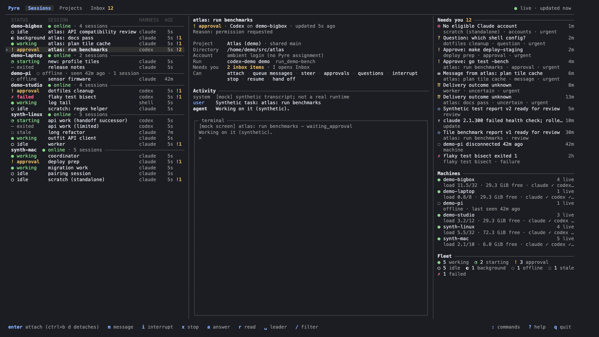 |
| Clean-up pass (200×55, mock) | 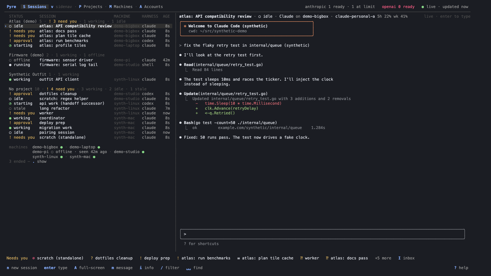 |
| Light terminal | 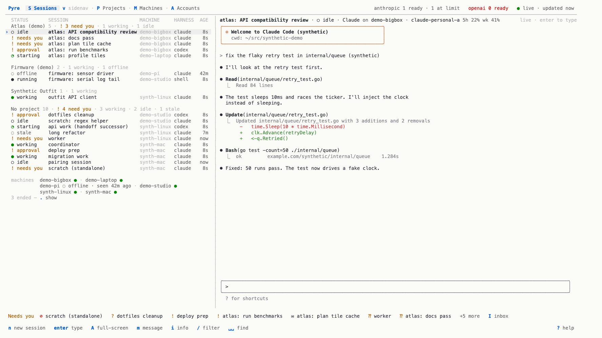 |

Embedded terminal (W-embed): [watching 240×65](screens/embed-watch-240x65-dark.png),
[typing 240×65](screens/embed-focused-240x65-dark.png), [info overlay](screens/embed-info-240x65-dark.png),
[watching 120×34](screens/embed-watch-120x34-dark.png), [typing 120×34](screens/embed-focused-120x34-dark.png).
Older captures below predate the embedded pane.

More: [240×65](screens/sessions-240x65-dark.png) ([before](screens/before-clean-sessions-240x65-dark.png)),
[120×34](screens/sessions-120x34-dark.png) ([before](screens/before-clean-sessions-120x34-dark.png)),
[60 columns](screens/sessions-60x24-dark.png), [which-key](screens/leader-whichkey-200x55-dark.png),
[finder](screens/finder-200x55-dark.png), [command line](screens/cmdline-200x55-dark.png),
[inbox (removed by W-attn)](screens/inbox-200x55-dark.png),
[help](screens/help-200x55-dark.png). The first pass
(WP15) is in the history of this file.

### Sessions

- **List.** Groups are quiet labels separated by a blank line, no rules:
  projects by default (see *Grouping* below), or machines (faint name +
  health dot; an unhealthy machine adds `◌ offline · seen 42m ago`).
  Columns STATUS · SESSION · MACHINE · HARNESS · AGE (MACHINE only when the
  machine is not the group header), ages right-aligned and dim. One signal per row: a session that is otherwise
  idle or working carries its attention flag instead of a separate badge —
  `! needs you` when it is blocked on you (approval, question, it asked for
  you, failed, needs re-auth, waiting on a prompt), `✉ message` (accent, not
  amber) when it only has a message for you. The status glyph carries the
  tone; the word is coloured only for approval / needs you / failed and dim
  for offline, stale and exited.
  A live shell reads `running` in the plain text colour (no agent is busy),
  so working agents stand out.
- **Lead signals (owner request 2026-10-14: "I should know when a project
  lead is worth clicking on").** Every lead (top-level session) carries one
  chip at the right of its title cell for itself and all its descendants,
  the highest of: `● asks N` (red; open asks from the subtree; its info
  names the soonest deadline), `◆ waiting` (amber; anything in the subtree
  needs you — a waiting-on-you, approval or question flag included), `•
  new` (accent; the lead, or a descendant, finished a turn — or the lead
  left you a message — after you last looked), `◌ working` (something in
  the subtree runs). A chip the row's own status already says (the lead
  itself works, or itself needs you) is left out; a quiet lead's title is
  dim; children rows are unchanged. "Last looked" is the latest of the
  session's OwnerActiveAt, the last time this TUI kept it selected for 2s
  (remembered per session in `tui-state.json` as `seen`, bounded, archived
  pruned) and the first launch with lead signals (`seen_since`). Turn end
  is the run's last report time while idle (`waiting_input`), or its end.
- **Live by default (owner: "can you clean up all of this cruft").** The
  list shows live sessions only: starting, working, waiting, needs you, and
  offline/stale (the run may still be alive). Ended sessions (exited,
  failed, no run) are hidden; a faint, clickable `3 ended — . show` under
  the rows (and `.`) toggles them, remembered as `show_ended` in
  `tui-state.json`. A machine with nothing listed keeps one faint line with
  its health dot: `studio-mac ● · no live sessions`.
- **Grouping (W-projgroup).** Owner request: "it would be nice to display
  by group / project on the left nav". The list groups by **project** by
  default: one group per project (`Atlas (demo) 5 · ● 2 asks · ◆ 1
  waiting · • 1 new · ◌ 1 working`: name, faint count, then its leads
  summed in the lead-signal words below, worst first, only non-zero parts;
  a project whose leads are all quiet reads faint with no summary), in a fixed order: projects by name, sessions inside a project in
  creation order (nothing reorders while you watch; a new session appends);
  Pinned stays on top; sessions without a project sit in a final `No
  project` group. A faint MACHINE column names each row's machine (the
  harness column drops first when narrow), and a quiet footer line keeps
  every machine's health in view so an offline machine is noticed:
  `machines  demo-studio ● 5 · demo-bigbox ● · demo-pi ◌ offline` — one
  line, the live-session count only when > 0; when it does not fit, whole
  items give way to `+N` from the end, never a wrap or a cut mid-item
  (owner report, W-tuifix). `g b` / `:group` cycle project → machine
  → repo → none; folds (`za`, enter, click), pins, the filter, `alt+↑/↓`,
  `alt+→`, the Grid's tile order and the switcher (which shows the project
  after the title) follow the grouping. The choice is remembered only once
  made: `tui-state.json` writes `"group"` with `"group_version": 2`; an
  older file without a group, or with `"machine"` (the old unwritten
  default), opens grouped by project, while an older explicit `repo` /
  `none` is kept. The machine view keeps its per-machine `no live sessions`
  lines and the ended-sessions machine rows (`X` archives all). Captures:
  [200×55](screens/sessions-200x55-dark.png),
  [120×34](screens/sessions-120x34-dark.png),
  [machine grouping](screens/group-01-machine.png).
- **Session trees (W-tree).** Owner request: "for the sidebar and maybe
  table views having a slightly indented view to display child parent
  relationships would be good." A session started by another session
  (`lineage.parent_session_id`, else `created_by {kind: session}`) sits
  directly under its parent inside the parent's group, in the sidenav list
  and the table, indented two cells per level behind a faint glyph: `├ `
  for a child with later siblings, `└ ` for the last, `│ ` guides on deeper
  levels (`│ └ long refactor`); the title is truncated after the indent
  (deep trees cap the indent at a third of the column). Parents keep the
  group's sort; children follow the same sort under their parent; lineage
  cycles are cut. A child whose parent is not in the same group (another
  project or machine, ended and hidden, archived) stays at the top level
  with a faint `↳ parent title` after the title, shown only when the whole
  title still fits. Children of a pinned parent follow it into Pinned.
  `za` on a parent, or a click on a child's glyph, folds the parent's
  descendants (the parent shows a faint `+N`; `za` again or a click on
  `+N` unfolds); folds are remembered (`folded_trees` in
  `tui-state.json`), a filter shows every match, and switching to a
  session under a folded parent opens it. `alt+↑/↓` and the Grid's tile
  order follow the displayed tree order; the switcher stays recent-first.
  The demo fleet has a cross-machine tree (planner on demo-bigbox →
  benchmarks on demo-bigbox and encoder spike on demo-studio → tile
  profiler on demo-laptop). Goldens: `sessions-tree-160`,
  `sessions-table-tree-120`.
- **Row markers: lead, single, recently yours (2026-10-13).** Owner
  request: "can we indicate in the sidebar if a conversation (the top level
  parent (if there's a big project)) or single conversation or one I've
  recently interacted with (i.e. actually sent a message to)". In the
  sidenav list and the table:
  - *Lead*: a top-level session with child sessions in its group (and no
    `↳ parent` elsewhere) has a **bold** title and a faint descendant count
    after it, `▾12` while open and `+12` folded; a click on either folds /
    unfolds. The count is what unfolding shows: descendants listed in the
    group (ended ones count only while `.` shows ended sessions).
  - *Child*: the tree glyphs above (`├ `, `└ `, `│ ` guides).
  - *Single* (no parent, no children): plain, no decoration; distinct by
    absence.
  - *Recently yours*: when the owner last messaged or typed into the
    session through Pyre (`session.owner_active_at`), an unselected row
    draws `▎` in its cursor slot: accent within the hour, faint within 24
    hours, nothing older (NO_COLOR: bold / faint). The selected row keeps
    its `›`. Grid captions add a faint `you 5m` (accent within the hour)
    before the machine; the facts (`i`, finder preview) read `You
    messaged or typed 12m ago` (omitted when never); `g s` / `:sort yours`
    lists the sessions you touched most recently first (children stay
    under their parents).
  The help overlay's legend names all four. Golden: `sessions-markers-160`.
- **Views (W-projgroup).** Owner request: Sessions has three views,
  switched inside the Sessions tab (`v` cycles, `G` toggles the grid,
  `:view sidenav|table|grid`, remembered as `sessions_view`): **sidenav**
  (default; this list with the live terminal on the right), **table**
  (full width, one row per session: STATUS · SESSION · PROJECT · MACHINE ·
  HARNESS · ACCOUNT · USAGE · ACTIVE, e.g. `claude-personal-a 5h 22% wk
  41%`; the column the list is grouped by is left out, narrow tables drop
  harness, project, account, then machine; spare width stays at the right;
  a resources column slots in once per-run stats exist) and **grid** (the
  live tiles). All three share grouping, pins, filter and selection. In the
  table `enter` (or `l` / `tab`) opens the session's terminal in the
  sidenav layout, typing, and `ctrl+]` returns to the table; `S` / `1`
  reopen Sessions in its current view. Captures:
  [table 200×55](screens/sessions-table-200x55-dark.png),
  [table 120×34](screens/sessions-table-120x34-dark.png),
  [grid](screens/grid-240x65-dark.png).
- **Attention (W-projgroup).** `g b` includes an attention grouping (`Needs
  you`, `Message for you`, `Working`, `Idle`, `Ended`; `:group attention`)
  and `g s` / `:sort attention` floats needs-you sessions to the top inside
  any grouping. The class comes from the run state, the session's attention
  count and its open attention items (only messages open: message for you),
  so it works with or without W-attn's per-session flags. Capture:
  [attention grouping](screens/sessions-attention-200x55-dark.png).
- **Archiving.** `X` archives the selected session: an ended one at once
  (toast: `:archived lists it`), a live one only after a confirmed stop
  (`Stop and archive`: the stop is sent and the session is archived once its
  run is observed ended; an unknown stop outcome archives nothing). While
  ended sessions are shown, each machine with ended sessions has a
  selectable header row (`synth-mac ● · 5 ended`); `X` there archives all of
  them after a confirmation listing them. Archived sessions never appear in
  the list; `:archived` lists them and `u` restores one. Archive and restore
  use `sessions.update` with `archived` and a stable operation id per
  session, so a retry never acts twice.
- **Terminal pane (W-embed).** Owner feedback on the old detail pane
  (facts, an Activity block repeating the transcript, then a framed
  snapshot of the same conversation, and a full-screen attach that
  suspended the TUI): "kinda lame and hard to use — why can't we just embed
  the thing / why do we repeat the messages". The right-hand pane now *is*
  the selected session's live terminal, full height, under one compact
  header line: `title · ● working · Claude on synth-mac · account ·
  bypass`, and nothing else above the terminal: no lease, embed or
  attention lines (the owner: internals). The pane state is one faint,
  short hint at the right edge, the most important first: `typing ·
  ctrl+] back to list`, `typing on server · enter to take over`,
  `needs you · a answers`, `needs you`, `typing elsewhere ·
  enter to take over`, `starting…`, `live · enter to type`,
  `disconnected · last screen`. An error is said once (a toast) and the
  pane stays calm (`couldn't connect to server — retrying`); a failed run's
  reason is plain text, never a persistent red line. The one exception to
  "nothing above the terminal": while the session has a message for you,
  one accent line under the header shows it — `✉ message for you: <first
  line> — m reply · d dismiss` (W-attn; messages show in their session, not
  an inbox). Project, directory, run and
  version, capabilities and how messages reach the session are behind
  `i` (info overlay). The Needs-you rail is gone; the one-line strip under
  the panes carries it at every width.
  - *Watching* runs the session's attach descriptor (`tmux attach -r`
    locally, `ssh -t host tmux attach -r` remotely) on a pty and emulates
    it with `charmbracelet/x/vt` into the pane: colours, cursor, alternate
    screen. A read-only client never takes the input lease (and Pyre's
    delivery ignores read-only clients). The pty is the pane size plus one
    row so tmux's status line sits below the pane, out of sight; with
    `window-size latest` the window follows the pane when the viewer is
    the only client (`-r` implies `ignore-size`, which tmux honours only
    while a sizing client is attached elsewhere).
  - *Typing*: `enter`, a click on the pane, or `tab`/`l` swap in a
    writable attach holding the run's input lease (renewed every 40 s,
    released after 60 s without keys while the pane stays focused, and
    re-taken on the next key, so an idle pane never blocks another
    client). When another of the owner's own clients holds the lease
    (the TUI on another machine) the pane offers `typing on server ·
    enter to take over`; enter or a click takes it over through the
    contract's takeover and that client drops to watching (`desktop
    took over · enter to take back`). A lease held by anyone else is
    never overridden from the pane. A run that is still starting shows
    `starting…` and attaches by itself (retry 0.5 s doubling to 2 s, and
    on the run's state change);
    every key goes to the session — ctrl keys, `ctrl+c`, bracketed paste,
    `shift+enter`/`alt+enter` as ESC CR (Claude Code's and Codex's
    newline). Mouse clicks and the wheel over the terminal go to the
    session (a left drag selects and copies instead, see Mouse), encoded for the mouse modes its tmux client enabled
    (SGR or X10) at pane-relative cells; Pyre's tmux servers run with
    `mouse on`, so tmux passes them to applications that ask for the mouse
    (Claude Code and Codex scroll their transcript with the wheel and take
    clicks) and scrolls its own history for those that do not. Against a
    tmux server with mouse off the wheel falls back to copy-mode (prefix
    `[`, then ctrl+up/down); typing text leaves copy-mode. `ctrl+]`
    (`term.unfocus` in keys.toml) returns focus to the list without
    blanking the view: the lease is released and a read-only client takes
    over. Any other way of leaving the pane (a click on the list, another
    view) does the same. While you type, Pyre's paste delivery sees a
    writable client and rings the doorbell instead.
  - Switching sessions switches the view (the emulator survives client
    swaps, so nothing flickers); at most two attach commands stay
    running, older ones are closed. Rendering is event-driven, at most
    ~30 frames a second, idle when nothing changes.
  - `F` (or `:attach`) keeps the old full-screen attach. A session with
    no embeddable terminal (no native attach, web-only, an ended run, an
    offline machine) shows why plus its last captured screen; `enter`
    falls back to the full-screen path.
- **Info overlay (`i`) and finder preview.** Title, one status line (`! approval · Codex on demo-bigbox ·
  6s ago`), the state reason in plain words (RFC 3339 times become `since
  21:20 (11m ago)`), then four labelled facts: Project, Directory (`~` for
  home), Account (agent harnesses only), Run. No capability list — the
  footer shows the keys that work; only an ended run lists what is
  unavailable. Labels are padded to the longest (`Permissions`,
  `Unavailable`) plus a gap and never run into their value; long plain
  values wrap with a hanging indent, and in a narrow pane (value column
  under 24 cells) the value moves under its label. A failed session leads
  with its reason in plain words, in red, right under the title (`Could not
  start: no eligible Claude account.`; else the exit code). One amber line when something needs you (`! Approve: go test
  -bench — a answers`, else the flag's text such as the session's own
  `Asks for you: …`), or when a remote approval expired and the harness
  fell back to its own prompt (`! Waiting on a prompt in its terminal —
  enter types into it`); one `✉ message for you: …` line for its message.
- **Honest states.** An offline machine: `lab-linux is offline (seen 19s
  ago); last observed running 16m ago.` + `The run may still be alive.`, and
  no fake loading. A machine that does not answer (hung, SIGSTOPped):
  `waiting for lab-linux… no answer for 7s` (counted across retries) while
  navigation keeps working.

### Grid (W-grid)

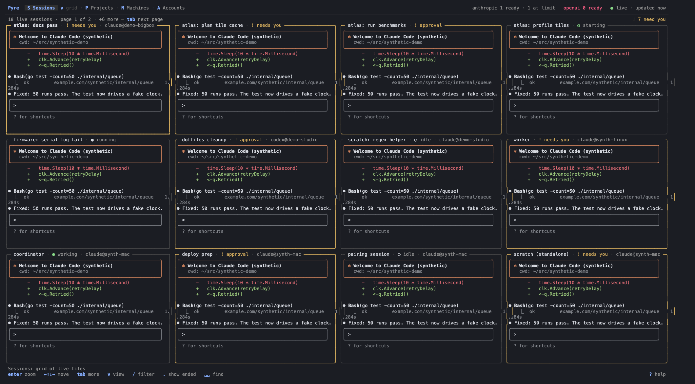

Mission control (`G`, `v`, `:view grid`; the grid view of Sessions — it was
its own tab until W-projgroup): every live session on every machine as a
small live terminal. [light](screens/grid-240x65-light.png),
[120×34](screens/grid-120x34-dark.png).

- **Layout.** Up to 12 tiles per page, arranged to the screen: the
  arrangement whose tiles are the largest terminal-shaped regions
  (`min(width/3, height)`, a small penalty per empty cell) — 2 side by side,
  4 as 2×2, 6 as 3×2, 9 as 3×3, 12 as 4×3 at 240×65; the last row's tiles
  share the full width. A smaller screen shows fewer per page (a tile is at
  least 28×10). One faint line above the tiles: `9 live sessions · page 1 of
  2 · +5 more — tab next page`, and at the right `! 3 need you`.
- **Captions** sit in each tile's top border: `title · ● working ·
  claude@synth-mac`; harness@machine drops first when narrow, then the state
  word. The selected tile has a heavy border (accent; `›` without colour).
- **Signals.** A tile that needs you (approval, question, a blocking
  attention flag, failed; a message alone does not count) has an amber border that breathes: bright for a second, soft for a
  second (0.5 Hz, colour only, no blinking text). Idle tiles are calm. A
  working tile's glyph becomes a small spinner only while its terminal is
  drawing, and settles when output stops.
- **Order.** Needs-you sessions first, then the most recently active (a
  state change or tile output); within a page tiles follow the Sessions
  list's order (Pinned, then the grouping — projects by default — then
  machine and title), so they do not shuffle while you watch. `tab` / `shift+tab`
  page.
- **Keys.** `←↑↓→` / `hjkl` move (up/down keep the column), a click selects,
  `enter` or a double-click zooms: the Sessions view with that session's live
  pane focused for typing (input lease). `ctrl+]` returns to the Grid (and
  any other way of leaving the pane does too). `esc` while typing goes to
  the session, as everywhere in the embedded terminal (Claude Code and Codex
  need it). `/` filters by text or machine (the same filter as Sessions),
  `.` shows ended sessions.
- **Tiles never resize an agent's window.** A tile is a read-only client,
  `tmux attach-session -t T -r -f ignore-size` (`-f` only on tmux ≥ 3.2),
  locally or through the same `ssh -t host bash -lc '…'` wrapper. tmux
  ignores an ignore-size client for sizing only while a non-ignore-size
  client is attached: verified on tmux 3.4 (Mac) and 3.6 (server), a 40×12
  `-r -f ignore-size` client alone shrank a 200×50 window to 40×11 and left
  it there. So before attaching, a tile asks the same server for the
  window's size (`display-message -p '#{window_width} #{window_height}
  #{status} #{version}'`, over ssh with `BatchMode`, no tty) and opens its
  pty at exactly that size (plus status lines): whatever tmux decides, the
  window keeps its size. Live tiles re-read the size every 10 s and follow
  it, so a human who attached with another size and leaves does not see the
  window snap back to the tile's old size (`TestGridRealTmux`). The emulator is window-sized; the tile draws the
  crop from the left edge that ends at the last row with content (tmux's
  status line excluded). A tmux attach whose window size cannot be read is
  not attached (the tile says why). A writable-only descriptor is never
  used for a tile (it would count as a human for delivery).
- **Bounded.** At most 12 tile clients (one page), repaints at most 15 a
  second and only when a tile draws, a pulse tick only while a needs-you
  tile is on screen; leaving the Grid (or zooming) closes every tile client.

### Attention flags, messages, overlays (W-attn)

- **No Inbox view** (W-inbox brought back a decisions-first one, and
  on 2026-10-15 it moved to the web app; see below). Owner: "I'm really not finding this inbox very useful
  at all … sessions should just be able to flag if they need attention".
  Each session carries a flag computed by the hub (`SessionView.Flag`:
  level + reason; `sessionAttention` in `attention_flag.go` is the one
  accessor the list, Grid, switcher, strip and grouping read). Blocking
  reasons — approval, question, `asked` (the session flagged itself with
  the `flag_attention` tool), failed, re-auth, blocked, uncertain delivery,
  conflict — read `! needs you`; messages, comments and reviews read
  `✉ message`. Flags clear at the hub: answering the request, the owner
  engaging with the session (typing into it, messaging it, reading its
  message), the session clearing its own flag, or its run ending.
- **Counts.** The Sessions tab counts leads that ask or wait on you (the
  needs-you rule rolled up to leads; `new` does not count) (`S Sessions
  3`, amber text); the strip under the panes lists them (`Needs you  ! deploy
  prep   ⁇ worker … · ✉ 1 message`) or says `✓ Nothing needs you · ✉ 1
  message   ● 5 working …`. Items that belong to no session (a machine
  offline, an update) live in the Machines / Environments views and the
  digest; `pyre attention` (CLI/MCP) still lists every item.
- **Messages in their session.** A message a session sent you shows in
  that session's view (terminal pane and info): `✉ message for you: <first
  line>`. `m` opens the composer replying to it (threaded, `in_reply_to`),
  `d` dismisses it (acknowledges without a reply). The line is built from a
  listing of your unacknowledged messages, never a by-ID read, because
  reading a message by ID counts as viewing it at the hub and would clear
  the flag while you merely browse. Session and machine IDs in hub text
  show as names everywhere (titles, finder, error toasts).
- **Finder.** `␣␣` still finds attention items by title (`attn` badge);
  `enter` opens what the item is about (the session, an artifact, a doc).
- Boxed overlays (answer, composer, help, prompts) float over the dimmed
  view they belong to, so the session stays in sight. Approval options no
  longer repeat their kind (`1 Allow`), and once answered the hints switch
  to `esc close`.
- Help flows into three columns at full screen, never splits a group,
  stays put while you type, and shows `↓ N more lines` when it overflows.
- Help ends with an "Agent commands" section: the slash commands every
  Pyre Claude session has (`/kickoff`, `/open-items`, `/ship`, `/brief`,
  `/deliver`, `/cleanup`, `/pair`), full width and wrapped, read from the
  embedded skills like `pyre commands`. Typing filters it with the keys.
  Goldens: `help-agent-commands-{60,100,160}`.
- Transcript search keeps each line's own styling and shows the current
  match reversed (`n`/`N`); consecutive tool calls read as one block.

### Inbox: in the web app (owner request 2026-10-15)

The TUI has no Inbox view and no inbox side panel any more. The owner:
"you should remove the inbox view in app and the inbox right sidebar /
there should still be an indication that there are questions (and maybe a
link to a filtered view in the web app)". The inbox (asks, threads,
answering) is the web app (`pyre web serve`, by default
`https://pyre-example.ngrok.app`); the TUI keeps the signal and links to it:

- **Header.** After the tabs, `● N asks` counts the open asks (amber; red
  when any is urgent or due within 15 minutes; hidden when none is open or
  the hub has no asks ops). It is an OSC 8 hyperlink to `<web>/#/inbox`,
  and a click on it opens that link.
- **Lead chips and project headers.** A lead's `● asks N` chip links to
  `<web>/#/inbox?session=<lead id>`, its info line's `● asks you N` too
  (with `I web inbox`); a project header's `● N asks` links to
  `<web>/#/inbox?project=<project id>`. Links take no cells, so layout and
  goldens are unchanged; terminals that support OSC 8 open them on click
  (usually with ctrl or cmd held while the TUI has the mouse).
- **`I` / `:inbox`** (aliases `:asks`, `:web`) open the link for the
  selection: the selected session's lead's asks when that lead has any,
  else the selected (or shown) project's asks, else the whole inbox. The
  opener is `open` (macOS) or `xdg-open`; with no display (no `DISPLAY` /
  `WAYLAND_DISPLAY`, or over ssh: `SSH_CONNECTION` / `SSH_TTY`) or a
  failing opener the link is copied with OSC 52 and the toast says so
  (`no display here — copied the web inbox link: …`).
- **Web URL.** `web_url` in the client config (`client.json`, beside the
  hub URL), overridden by `PYRE_WEB_URL`; default
  `https://pyre-example.ngrok.app` (`tui.DefaultWebURL`).
- The state file's old `inbox_panel_hidden`, `inbox_split` and
  `inbox_sort` are ignored.

### Accounts (W-usage)

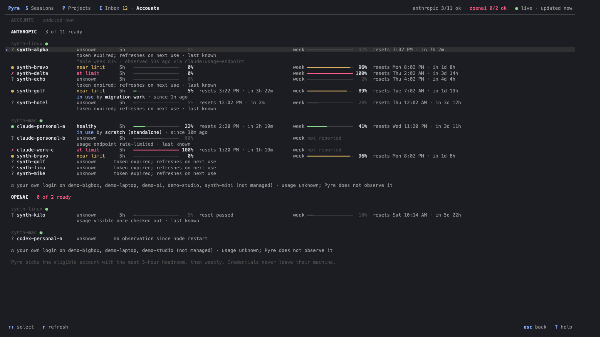
([selected card](screens/accounts-selected-200x55-dark.png),
[120×45](screens/accounts-120x45-dark.png),
[light](screens/accounts-200x55-light.png),
[session info with an account switch](screens/session-info-switch-200x55-dark.png);
synthetic labels on the shapes of a real pool via `demo -fixtures`.)

- One section per provider: `Anthropic · 7 ready · 1 at limit` (counts
  toned like their chips) with a 16-cell stacked mini-bar (ready green,
  near amber, at limit / re-auth red, unknown faint), a faint column
  header, then one row per account identity (W-acctui): state chip
  (`● ready` green, `◐ near limit` amber, `✕ at limit` red, `○ unknown`
  dim, `↻ re-auth` red), label, kind (`token`, `rota`, `login`, `own
  login`), machines (`all machines`, a machine, `2 machines`; dropped
  below ~150 columns), smooth 5-hour and weekly bars in partial blocks
  (`▏▎▍▌▋▊▉█`, accent below 60 %, amber to 85 %, red above; empty cells on
  a subtle track in 256/truecolor, faint `░` otherwise), `% used`, the
  reset as `in 2h 19m` with the absolute time faint (dropped first when
  short of room), a dim `reserve` for an account in the reserve tier
  (`pyre accounts tier`), and `1 session` in use. Below ~118 columns the bars go on
  a second line. The row's state is its best login's (as `usage.Pools`
  counts it). The selected row expands: machines with by-machine
  readings, the sessions on it (`<session> on <machine> · since 30m ago`),
  model-scoped/extra windows, the tier of a reserve account and a note on
  the state.
- State in plain words (`internal/usage`, shared with the CLI, the
  selector and Android): healthy, near limit (5h or weekly ≥ 80 %, amber),
  at limit (red, until the reset), needs re-auth (grant expired/dead, or
  login unusable), unknown + why (`token expired; refreshes on next use`,
  `usage visible once checked out`). An unknown login that still carries
  windows draws them faint with `last known`: numbers, not capacity. The
  extra-usage budget is never a limit; model-scoped weeklies (`fable week
  37%`) and extra usage appear on the selected card's faint line with the
  source and observation age.
- The owner's own login on machines without Pyre accounts for
  the provider is one quiet line per provider: `○ your own login on
  demo-bigbox, synth-mini (not managed) · usage unknown`.
- Session info (`i`): `Account  dev-server anthropic · ● healthy · 5h 12% ·
  week 40%` and, under it, each switch Pyre made from the session's
  fallback plans: `↳ switched from claude-work-c to claude-personal-a at
  11:57 AM (limit reached)` (handoff, waiting and needs-you variants). The
  terminal header carries the account's usage at a glance: `dev-server 5h 12%
  wk 40%` (amber near the limit, red at it; `at limit` / `re-auth` when that
  is the news). The sidenav rows have no room for a per-row usage badge at
  120 columns, so it lives there and in the table view's ACCOUNT · USAGE
  column.
- Launch review: `Account  dev-server — most headroom (5h 12% used, weekly
  40%) · observed 2m ago` (`only eligible account (…)` without a choice).
- Recent switches under the rows: the last three automatic account switches
  (or limits with no other eligible account) as `audit.Line` (dim, amber
  `↻`), `a all activity`; `no automatic account switches yet` when there are none. Omitted
  on hubs without the audit log.

### Activity (W-audit)

- `␣l`, `:activity`, or `a` in Accounts (pre-filtered to accounts). The
  owner-facing audit log from `audit.list`, newest first (200 per page, at
  most three pages): `14:05 synth-mac ↻ switched 'Credit perf' from code
  (weekly 96%) to me (weekly 0%) — limit reached`. `↻` marks what Pyre did on
  its own; account switches and limits with nowhere to switch are amber.
- Filter row `all 23 · accounts 9 · sessions 8 · fleet 6` (`f` cycles;
  counts from the unfiltered log once loaded). The selected entry's detail:
  summary, When (full time), Where, Who, What, Why, Session, Run, Account,
  From/To with the usage notes captured at the time. Stacked under the list
  below 150 columns, beside it from 150.
- Reloads on `r`, every 30 s while shown, and on account./session./node.
  events. A hub without `audit.list` shows `this hub does not offer the
  activity log; upgrade pyre-hub`.

### While you were away (W-digest)

- **On launch** the TUI builds the digest since this client's last-seen
  mark (`internal/digest`; the mark `pyre digest` uses, in
  `digest-state.json` beside `tui-state.json`; 12 h on first use). When
  anything happened, one calm toast says so on the Sessions view (`While
  you were away: 5 agents, 2 need you — :digest shows it`; not on first
  launch, where the tips bar speaks). The digest is its own view (it used
  to sit on top of the Inbox, which W-attn removed): `:digest` / `:away`
  or `␣w`. Nothing happened: no toast, and `:digest` says so in a toast.
- **Panel** ([200×55](screens/digest-inbox-200x55-dark.png),
  [light](screens/digest-inbox-200x55-light.png),
  [120×34](screens/digest-inbox-120x34-dark.png),
  [launch toast](screens/digest-launch-200x55-dark.png)): a header line
  (`While you were away · since 09:12 (3h ago) · 5 agents, 2 need you`,
  `esc mark seen` at the right edge), then one row per agent ranked needs you
  (`!` amber: an attention item; `✗` red: blocked — failed run, accounts
  exhausted, waiting on a prompt in its terminal) → done (`✓`) → still
  working (`●` green), newest first within a rank. Columns: title, the
  one-line summary (the attention item's title, the blocker, else the first
  sentence of the agent's last message), a compact facts column (`2 turns ·
  2 files · 1 artifact`, or `Claude on server` for needs-you rows; dropped
  under 110 columns) and the age. One faint line collapses the rest: `2
  quiet sessions` (observations only, or archived) and items that belong to
  no session (`! synth-linux was offline for 12 minutes`). The panel fills
  the view's left column and scrolls (`3 more agents (j/k)`).
- **Cursor**: `j`/`k` move through the rows. The detail pane ([detail](screens/digest-detail-200x55-dark.png)) shows
  the whole summary, `Activity` (turns, tool calls, replies; "at least"
  when the transcript window did not reach the cutoff), `Needs you`,
  `Blocked`, `Files` (relative to the run's directory), `Artifacts`,
  `Docs`, `Notes`, `Messages` (`→` sent, `←` received), what `enter` does
  and the line's `pyre://` deep link; the wide layout's right column shows
  the session's live activity.
- **enter** follows the line's link: a needs-you row opens its session
  (where `a` answers); a row with a transcript moment opens the reader
  scrolled to that entry ([moment](screens/digest-moment-200x55-dark.png),
  toast `at the moment of: …`); a blocked row opens the live session, or
  its transcript when the session has ended (ended sessions are hidden from
  the live list). `r` opens the transcript at the moment for any row. A
  click selects a row; a click on the selected row opens it.
- **Seen**: `esc` (or a click on `esc mark seen`) moves the mark to the
  newest event and goes back; quitting after the digest was on screen
  does the same; a digest never looked at stays for the next launch.
  Without a state file (tests, embedders) there is no digest.
- Review it with `go build -o /tmp/pyre-digest-demo ./internal/tui/digestdemo`
  (synthetic fixture, throwaway state directory) and
  `screenshot.py --cmd /tmp/pyre-digest-demo "_launch@2=" "digest=␣w"`.

### Search everything (W-search)

`␣/` (or `?text` in the finder) searches every session transcript on every
machine, live and ended (`ctrl+t` adds archived ones), plus Hive memory and
the hub's notes, documents and artifacts. Results arrive while you type
(after a short pause) and are grouped by session: the title with machine and
age, then one row per match (`you` / `agent` / `tool`) with the matched words
highlighted, best session first. Machines that were not searched say so in
one dim line above the results (`◌ studio-mac not searched (offline)`), never
silently. `enter` moves to the results, `enter` again opens the transcript
reader at that turn with the match current (`n`/`N` continue), `a` attaches,
typing refines, `/` edits the query. The preview shows the session's state,
where it ran and the full snippet.
[Results 200×55](screens/search-03-results-200x55-dark.png),
[typing](screens/search-02-typing-200x55-dark.png),
[light](screens/search-03-results-200x55-light.png),
[120×34](screens/search-03-results-120x34-dark.png),
[reader at the match](screens/search-05-reader-200x55-dark.png).

### New session (W-newsession; replaces the W-quicklaunch/W-qlpath line)

`n` opens the **New session** panel: a centered form over the dimmed view
(owner: "still pretty clunky; scrolling through the list resets machine and
everything; … a different selection mechanism is needed", then: "you should
select the machine first and repo or folder (the folder selection is really
bad)"). Every field is labeled and stacked; the focused one is marked `›`.
The machine comes first, because Where, the agents and the model choices
all depend on it.

```
╭─ New session ────────────────────────────────────────────────────────────────╮
│ › Machine    ● synth-linux  1/16 runs · cpu 7% · mem 40%    claude shell  auto │
│              ○ synth-mac    2/8 runs · cpu 18% · mem 63%    claude codex shell │
│   Where      (atlas)                                                         │
│              Repositories on synth-linux                                     │
│              › atlas          ~/src/atlas         demo/atlas   contributed 26h ago │
│              Recent folders on synth-linux                                   │
│                ses_synth-b    ~/work/ses_synth-b               used 30m ago  │
│                ⇣ Clone a GitHub repo here…        any repository not on synth-linux │
│                📁 Browse folders…                 any folder on synth-linux, or a new one │
│   Agent      ● Claude   ○ Shell   auto                                       │
│   Model      ● default                                                       │
│   Effort     ● default                                                       │
│   Workspace  ● main checkout   ○ fresh worktree   ○ new branch   auto        │
│   Account    ● auto   ○ claude-personal-a   ○ claude-work-c                  │
│   Prompt     optional first prompt (shift+enter: new line)                   │
│   Title      auto (named from the prompt)                                    │
│ ──────────────────────────────────────────────────────────────────────────── │
│ Claude on synth-linux · demo/atlas · main checkout · account auto            │
╰──────────────────────────────────────────────────────────────────────────────╯
```

- **Machine** lists every node, one row each, with its load as the Machines
  list shows it (runs, CPU or load per core, memory) and the agents it can
  run; disconnected nodes are faint (`offline · seen 3h ago`) and cannot be
  chosen. ↑/↓ (←/→, space, a click) choose; ↓ past the last machine moves
  on to Where; typing a letter there filters Where. The automatic machine
  (`auto`, fixed when the panel opens) is this machine when it is a node,
  else the machine last used from the panel, else the least loaded.
- **Where** is a type-to-filter list (fuzzy) scoped to the chosen machine:
  *Repositories on <machine>* (its checkouts in `repos.catalog`), then
  *Recent folders on <machine>* (where sessions ran there lately, and
  `home`), then two rows pinned under the list: "⇣ Clone a GitHub repo
  here…" and "📁 Browse folders…". Other machines' repositories are not
  mixed in; changing the machine re-scopes the list and keeps the filter
  text (a folder chosen on the old machine and added repositories are
  dropped). A filter that matches a repository only on other machines adds
  *On other machines* rows ("notes-app · on synth-mac · enter: switch
  there", the machine last used with it, else one that has it): Enter or
  `^s` switches the machine (and `^s` starts there) instead of cloning a
  second copy. A filter matching nothing anywhere highlights Clone when
  repositories elsewhere or on GitHub match (its row says how many), else
  Browse. ↑/↓
  (and the wheel) move the highlight and **never change another field**.
  `+` adds the highlighted repository and starts a new filter: several
  repositories get fresh worktrees in `~/pyre-work/<slug>/`.
- **Clone a GitHub repo here…** (Enter or a click) turns the list into the
  repositories the machine lacks and can clone (GitHub, or present
  elsewhere with a remote), filtered by the same text; `owner/name` the
  catalog lacks is offered too. Starting clones it first (`repo.clone`);
  Esc returns to the machine's list.
- **Folder picker** ("📁 Browse folders…", or any path typed in Where:
  `/…`, `~…`, `./…`, `../…`, `C:\…`; a lone `.` or `..` stays a filter
  until its slash) replaces the list with the chosen machine's
  filesystem (`dir.list`). The input is a path; the current folder is the
  header (`in ~/src on synth-linux (~ is /home/demo)`). Tab completes the
  last segment: a unique prefix is entered, several extend to their common
  prefix and are listed ("2 folders: api  apps"). `~` at the start of a
  segment goes to the machine's home, `/` to the root. ↑/↓ move, → or Enter
  on a folder goes in, ← (or Backspace on an empty segment) goes up with the
  folder left highlighted. With an empty segment the list also offers `⌂
  home`, `⑂ worktrees` (the node's `--worktree-root`) and up to three
  recent folders there. Only folders show; dot-folders only when the
  segment starts with `.` (a separate `hidden` listing, asked for only
  then). "✓ Use this folder" (Enter) chooses it; a typed name that does
  not exist reads "✓ Use ~/src/new · new folder, created first"
  (`fs.mkdir` when starting). "New" needs evidence: the listing lacks the
  name, or the node says the folder does not exist; Use waits while the
  listing loads; a listing that timed out or was refused leaves the folder
  "not verified" (Use starts there) and a transient failure is retried.
  `^s`/`^⏎` and `[ Start ^s ]` use the picker, never Where's rows: the
  highlighted folder when you moved to it (or it is exactly what you
  typed), else the typed path. `./x` and `../x` resolve against the TUI's
  directory on this machine; another machine has none, so they start at
  its home. On a Windows node (its platform, or a drive-letter home) paths
  keep forward slashes, `\` is a separator, `/` goes to the drive root,
  `C:` to that drive, and ← stops at the root. Each listing is fetched
  once per panel (cached for its lifetime; a spinner while it loads); an
  offline machine is named and polled, and listed again when it returns. Choosing fixes Machine to the browsed one and leaves
  agent, workspace and the rest untouched; Esc returns to the list.
  `dir.list` gained `hidden` and returns `home` and `worktree_root`; an
  older pyred ignores them: no dot-folders (the picker says so), no
  worktrees shortcut, home taken from its listing of `~`.
- **Agent, Model, Effort, Workspace, Account** are segmented pickers: every
  option visible, ←/→ (space) or a click changes them; `^o`/`^t` cycle
  machine and agent from anywhere. Agent offers only what the machine can
  run (an unavailable harness is not offered; a node reporting none offers
  Claude, Codex and Shell); a choice the new machine lacks falls back to
  `auto`. Model and Effort list the machine's choices for that agent. A
  field you have not set shows its automatic value, marked `auto`: Agent
  and Workspace default to what was last used with the repository
  (remembered per repository in the TUI state file, with the last machine
  and agent overall). Workspace: main checkout / fresh worktree / new
  branch (type the name); not shown for folders. Account: auto (eligible)
  or a specific account of the agent's provider.
- **Prompt** is multi-line (shift+enter, alt+enter or ctrl+j for a new
  line); **Title** is optional (auto from the prompt).
- **Keys:** Tab/Shift-Tab move between fields (↑/↓ too outside the lists);
  Enter moves on and on Title starts; `^s` or `^⏎` starts from anywhere;
  Esc cancels (in the clone list or the picker it goes back first); `^a`
  opens the step-by-step launch. Mouse: click a field, an option, a machine,
  a row, `[ Start ^s ]` or `[ Cancel ]`.
- **Summary and validation:** one line says exactly what starts ("Claude on
  server · acme/atlas · fresh worktree pyre/fix-cache · account auto");
  problems show inline (`!` by the field, the reason at the bottom) and
  starting is refused: nothing chosen, offline machine, a machine with no
  agent, a repository without a remote that the machine lacks, an empty or
  invalid branch name.
- **Starting** runs the steps in the panel with progress ("◌ cloning
  demo/orbit on synth-linux (not there yet)… 12s", then the worktree, then
  the session); each step has its own operation id, so a retry after an
  unknown outcome never clones, creates or starts twice. A clone never
  overwrites a directory (`repo.clone`).

Goldens: `newsession-open-120` (Machine first, the machine's repositories
and recent folders), `newsession-120` (typed repo), `newsession-fields-120`
(synth-mac, Codex, fresh worktree, multi-line prompt, title),
`newsession-clone-120` (the clone list: will clone), `newsession-picker-home-120`
(picker at ~ with its shortcuts), `newsession-picker-120` (Tab on an
ambiguous prefix). The screenshots below predate the form and need
regenerating with `screenshot.py`.

| | |
|---|---|
| Open (recent repositories) | 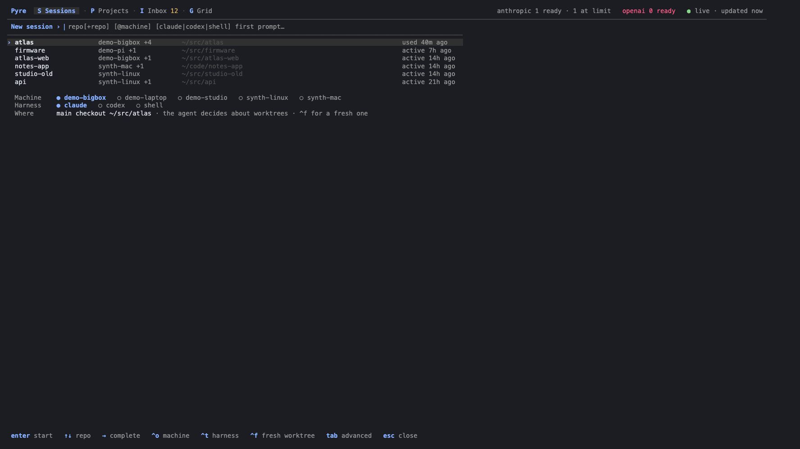 |
| Typed, fresh worktree | 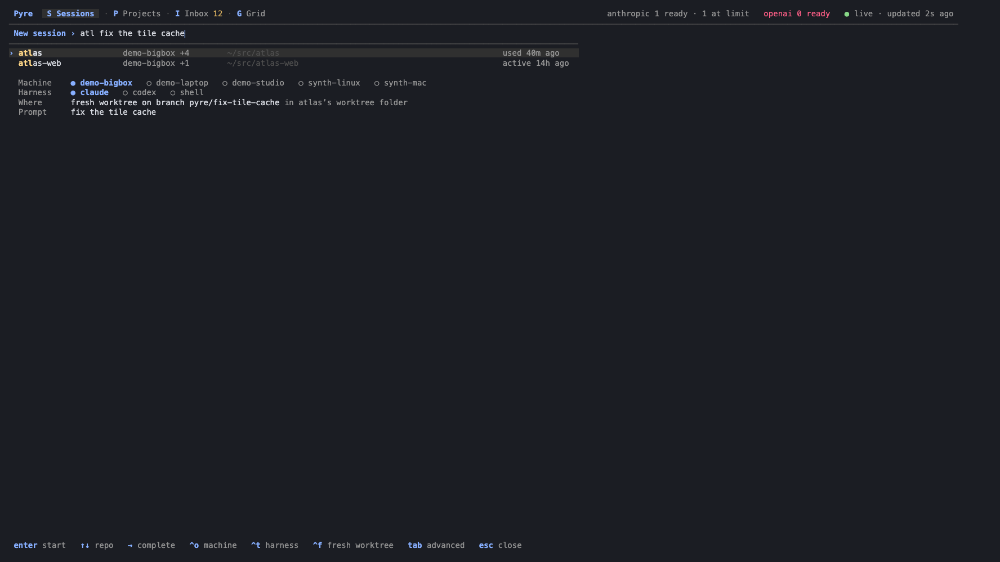 |
| Two repositories | 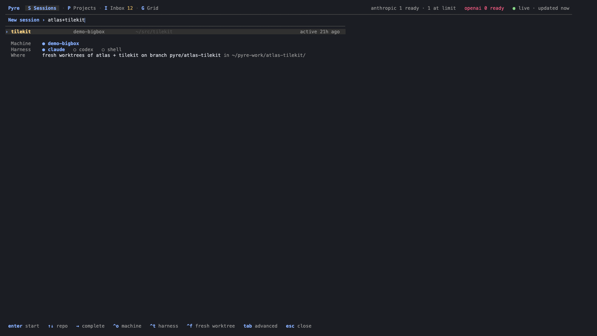 |
| `i`: the session's worktrees | 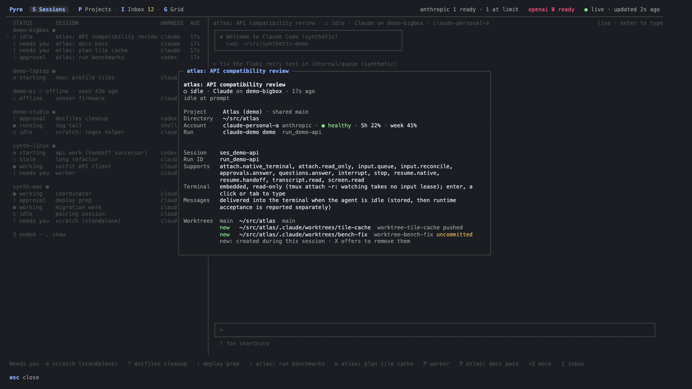 |

The `i` overlay lists the worktrees of the repositories the session
touched, as its machine last reported them (`main`, `new` = created during
the session, the agent's own `.claude/worktrees/*` included, `fresh` =
created by the bar or `pyre new --fresh`), with uncommitted/merged/pushed.
Archiving the session (`X`) then offers to remove the ones it created: a
toast names them and `W` opens the panel (golden `worktree-cleanup-120`),
bound to that session. It never opens by itself — it used to pop up
seconds after a confirmed stop+archive, which looked like the confirm
reappearing over the next selected row (owner report, W-tuifix). In the panel Enter, `n` and esc keep them; `y` removes
the clean ones through the machine, which re-checks every rule (never the
main checkout, never anything uncommitted, a branch neither merged nor
pushed is kept and the toast says so).

### Switching sessions (W-switch)

Owner request: "an easy way to move between sessions (quick search like
leader + s in my tmux … holding alt/option and arrow keys would be ideal)".
Switching works from anywhere, including while typing in the embedded
terminal — no `ctrl+]` first:

- `alt+↑` / `alt+↓` (`sessions.prev` / `sessions.next`): the previous / next
  session in the Sessions list's visible order (Pinned, grouping and filter
  respected; folded groups' rows, machine header rows and archived sessions
  skipped). The ends stop with a quiet `top of the list` / `end of the
  list` toast rather than wrapping. From another view they open Sessions.
- `alt+←` (`sessions.last`): back to the previously viewed session, toggling
  like tmux's last-session (a session counts as viewed once its preview
  loads, i.e. after a short dwell, or when a switch lands on it).
- `alt+→` (`sessions.attention`): the next session that needs you (approval,
  question, attention), cycling in list order; one inside a folded group
  opens its group.
- `alt+s` or `␣s` (`global.switcher`): a small centered switcher, like tmux
  `prefix s`: type to fuzzy-filter (the finder's fzf matcher over title,
  machine, harness, status, project, repo, tags), recent first (what you
  viewed, then latest activity), the current session on top marked `·
  current` and the cursor on the previous one, so `alt+s enter` toggles.
  `↑↓` / `ctrl+j/k` / `tab` move, `enter` switches, `esc` (or `alt+s`)
  closes. Opening it costs ~15 ms with 600 sessions under `-race`
  (`TestSwitcherOpensFastWithManySessions`). `␣s` used to open Sessions,
  which keeps `S` and `1`.

Typing focus follows a switch made in the terminal: the old session's
writable attach and input lease are released at once, the new session's
terminal shows read-only immediately with `typing` in its header and the
status line `keys go to the session (the next key takes the input lease)`;
the next key, click, wheel or paste takes the lease (never a silent
takeover of another client's lease: a refusal is explained as for `enter`)
and is then delivered. Flicking through sessions therefore takes no lease
at all, and the switch chord's bytes never reach the harness. `esc` from a
switcher opened in the terminal returns the keyboard to it.

| | |
|---|---|
| `alt+s`: recent first | 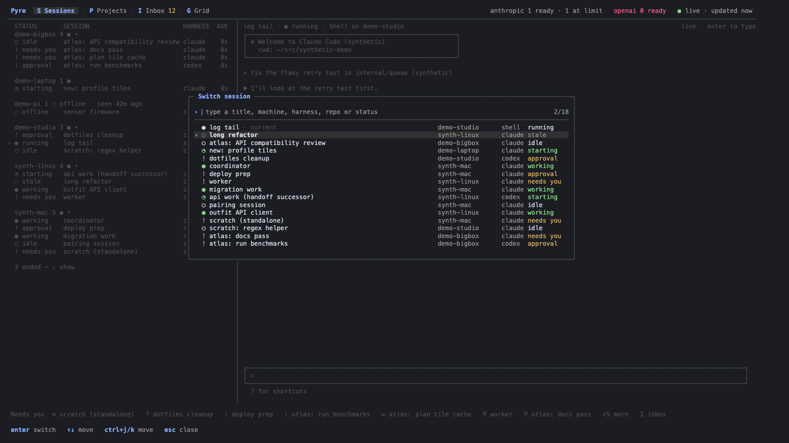 |
| Typed `atl` | 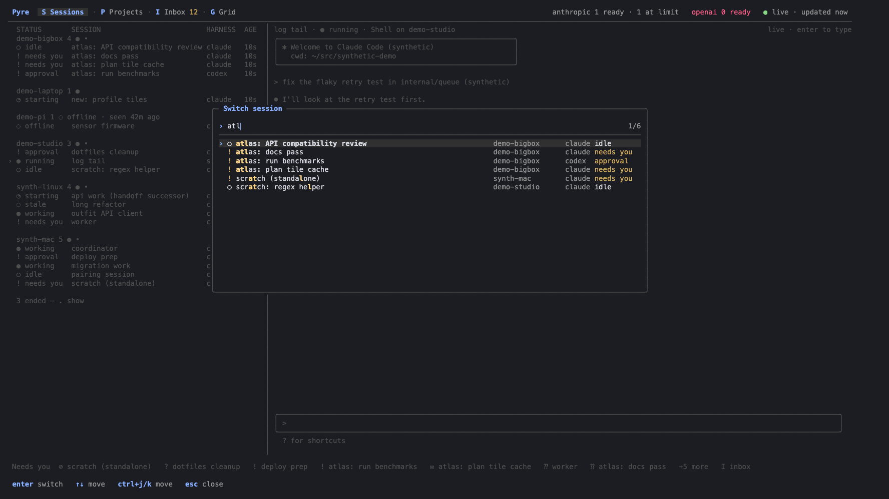 |
| `alt+↓` while typing: focus followed | 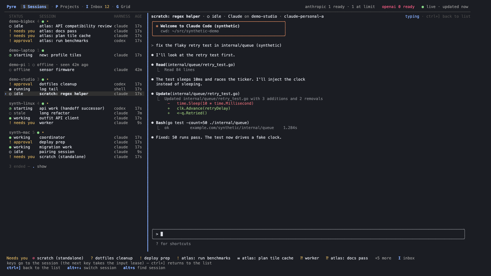 |

Key encodings. Terminals send option/alt+arrows as xterm `CSI 1;3A..D`,
iTerm2-style `CSI 1;9A..D` (Meta, folded into alt) or ESC-prefixed arrows
(`ESC ESC [ A`); all three decode to `alt+up` … (`TestSwitchChordEncodings`).
macOS Terminal.app by default sends `ESC b` / `ESC f` for option+←/→ — the
readline word motions. Pyre treats them as `alt+←` / `alt+→` only outside
the embedded terminal (`macos_option_arrows = "list"` in keys.toml;
`"always"` also inside it, `"off"` never), so `alt+b` / `alt+f` keep
working in Claude and shells. For option+arrows (and `alt+s`) everywhere,
make option send Meta:

| Terminal | Setting |
|---|---|
| Terminal.app | Settings → Profiles → Keyboard → "Use Option as Meta key" (then option+↑↓←→ send `ESC`-prefixed arrows) |
| iTerm2 | Settings → Profiles → Keys → General → Left/Right Option key: "Esc+" |
| Ghostty | `macos-option-as-alt = true` (or `left`) in the config |
| kitty | `macos_option_as_alt yes` in kitty.conf |
| WezTerm | `send_composed_key_when_left_alt_is_pressed = false` (the default) |

Inside tmux. Verified with real tmux servers on private sockets (`-L`, `-f
/dev/null`: prefix `C-b`, no `M-` arrow bindings in the root table,
`extended-keys off`, i.e. the owner's server setup), the TUI demo in a pane and
a tmux client in a pty playing the outer terminal: xterm, iTerm2-style and
ESC-prefixed alt+arrows, `alt+→`, `ESC b` in the list, `alt+s` and switching
while typing all reach the TUI and behave as above, `ESC b` inside the
terminal stays the harness's, and no switch bytes reach the session — tmux
3.6 on server and tmux 3.4 on the Mac, 16/16 checks each
(rerun with [`switch_tmux_check.py`](switch_tmux_check.py)). A tmux config that binds `M-Up` …
in the root table (`bind -n M-Up …`) takes those keys before Pyre sees
them; rebind the Pyre actions in keys.toml (for example `"sessions.next" =
"ctrl+down"`) or drop the tmux binding.

### Footer and header

- Footer: up to seven view keys plus `? help` (and `esc back` in sub-views).
  Everything else is behind `?`, the `␣` which-key popup and `:`. The
  Sessions footer always starts with `n new session` (owner feedback: "I
  don't understand how to start sessions from within pyre"), and an empty
  Sessions view says `No sessions yet — press n to start one (or ␣n
  anywhere)`.
- **The bottom belongs to the terminal (W-browse).** Owner: give the bottom
  of the screen back. In the Sessions sidenav (100+ columns, no panel open)
  there is no full-width bottom row: the Needs-you / fleet summary ("✓
  Nothing needs you · ● 9 working · ○ 5 idle", or "Needs you ! deploy prep
  ⁇ worker …"), the toast or status (filter input, key focus note, an
  unfinished key sequence) and the key hints form the sidebar's footer
  block (see "Sidebar footer" below), so the embedded terminal pane
  reaches the screen's last row. The
  Sessions table and the grid keep one slim bottom line: hints on the left
  (or the filter input), a toast or the compact summary ("! 3 need you",
  "✓ ● 9 working …") on the right. Other screens, open panels and narrow
  layouts keep the status line and the hint line. Goldens: `sessions-160`,
  `sessions-100`, `sessions-table-120`.

```
  ! needs you  scratch (standalone)            synth-mac   claude   30s  │
                                                                         │
  machines  synth-linux ● 4 · synth-mac ● 5                              │
  1 ended — . show                                                       │
  …                                                                      │
 ──────────────────────────────────────────────────────────────────────  │
 Needs you  ! deploy prep   ⁇ worker   ⊘ scratch (standalone)            │
 n new session      enter type         F full-screen                     │
 m message          i info             / filter                          │
 ␣␣ find            ? keys                                               │
```

  **Sidebar footer (W-archive2).** The owner: the key hints "wrap to
  multiple lines in a weird way". The footer is a fixed block that never
  wraps mid-item: a faint rule, the Needs-you / fleet summary (one line),
  the toast or status (one line, truncated with …; a click on a toast
  shows its full text, up to four lines, and keeps it until a second click
  dismisses it), then the key hints as an aligned grid of `key label`
  cells: up to three equal columns (compact: at most the widest cell + 4)
  and three rows sized to the sidebar width. Lower-priority hints drop when
  they do not fit; `? keys` always stays, in the last cell. Golden:
  `sidebar-foot` at sidebar widths 56, 64, 72 and 80.
- **Session icons (W-archive2).** Owner: "make it so chats can set an
  emoji in their title". A session may carry one emoji (`Session.icon`;
  one grapheme, at most two cells), drawn before its title wherever titles
  show: sidenav and table rows, grid tiles, the switcher, the detail and
  terminal headers, the reader, project lists. Width math counts a wide
  emoji as two cells, so columns stay aligned. `:icon 🚀` sets the
  selected session's icon, `:icon` clears it; agents use MCP
  `set_session_icon` (pre-approved) or `rename_session` with `icon`, the
  CLI `pyre sessions icon <s> [emoji]`. Automatic titling never changes
  it. Goldens: `sessions-icon-100`, `sessions-icon-table-100`.
- **Reparenting (W-reparent).** Owner: "ability to reparent" sessions (a
  coordinator's agents handed to two leads). `>` on a session opens a
  switcher-style picker titled "Move <title> under…": every listed session
  except the session and its descendants, marked `· current parent`, plus
  "top level (no parent)" when it has one; `enter` moves it. `:parent
  <session>` / `:parent none` do the same without the picker. The tree
  re-lays at once (the hub's answer patches the cache). A reparented
  session's detail reads "Reports to <lead> (reparented from
  <coordinator>)" instead of "Started by". The hub retargets pending
  automatic reports and tells both sides with a Pyre message; agents use
  MCP `reparent_session` (pre-approved), the CLI `pyre sessions reparent
  <session>... --to <parent|none>`.
- Header: tabs carry their keys, `Pyre  S Sessions v sidenav · P Projects ·
  M Machines · A Accounts    ● live`; `1`–`4` follow the
  tabs (Sessions, Projects, Machines, Accounts); in an answer box `1`–`9`
  answer. Owner request (W-projgroup): the Grid is a view of
  Sessions, not a tab; Accounts and Machines are tabs; there is no Inbox tab (attention flags show on the sessions — W-attn; the
  inbox is the web app, and `● N asks` after the tabs links to it; the
  digest is `␣w`). `v sidenav` beside the active Sessions tab names
  the Sessions view and a click cycles it. `M` and `A` open Machines and Accounts everywhere (full-screen attach moved
  to `F`, message history to `H`); `4` /
  `␣a` and `3` / `␣m` open Accounts and Machines from there. Narrow
  terminals drop the view switch, then the inactive tabs' labels (`S
  Sessions · P · M · A`), before the connection state loses its words.
  The connection state is fixed width so the header never reflows on
  ticks (owner report, W-tuifix): `● live` (event stream connected) or
  `○ synced` (polling); only once the sessions data is older than 30 s
  does it grow to `● live · stale 45s` (amber). Left of the freshness label, the account pool: `anthropic 3 ready ·
  5 near limit   openai 1 ready` (one count per account, `usage.Pools`,
  shared with the CLI, the selector and Android); the ready count is calm
  and only the near/at-limit part is amber. Available = room in its
  current or last-known windows, including a login whose token refreshes on
  use or whose Codex usage is visible only once checked out (`ready ·
  refreshes on use`). The ready count turns
  red when none is available; a click opens Accounts. It is the
  first thing dropped when the header is short of room.
- First launch: a one-line tips bar above the status line lists the five
  most useful keys (`n new session · enter type in · 1-4 switch tabs · ␣␣
  find anything · ? help`). `esc` (with nothing else to close) or a click on
  `hide ✕` dismisses it for good: the CLI remembers that in `tui-state.json`
  beside the client config (`Options.StateFile`; without one, as in tests,
  there is no tips bar).

### Mouse

Cell-motion mouse mode (Bubble Tea v2 `View.MouseMode`). Clickable regions
are marked while the frame renders (private zero-width CSI markers that
the layout helpers measure as escape sequences) and stripped before the
frame is written, so hit testing matches exactly what was drawn.

- Click a header tab to switch view; click a project section tab to open
  that section.
- Click a list row to select it; click the selected row again (or
  double-click) to open/attach it, like `enter`.
- Click a child session's tree glyph (`├ ` / `└ `) to fold its parent's
  children; click a folded parent's `+N` to unfold them.
- Click any key hint (footer, tips bar, empty states, the Needs-you rail) to
  press that key; hints naming several keys (`↑↓`, `1-9`) are not clickable.
  With an overlay open only its own footer hints click.
- Click a pane to focus it (the detail pane separator lights up). In
  Sessions a click on the terminal focuses it (input lease) and is passed
  through to the session (e.g. Claude's "Jump to bottom (click)"): the
  press is held back until the release shows it was a click, then press
  and release are sent together.
- Select and copy (owner report: "in normal claude/codex you just select
  and it copies to my clipboard even when ssh'd"; `termselect.go`): a left
  drag highlights cells (reverse video) and the release copies them to the
  system clipboard with OSC 52, like a native terminal with Claude Code. A
  double-click copies a word. Over the embedded terminal the selection is
  of the emulator's cells (clamped to the pane), never reaches the session
  as mouse input and never takes the keyboard; anywhere else (lists,
  detail panes, panels, header) it selects the drawn frame's text. The
  highlight stays until the next press or key into that terminal. OSC 52
  works locally and over ssh; inside tmux the outer tmux needs
  `set -g set-clipboard on` (the default `external` ignores OSC 52 from
  applications) and the outer
  terminal must allow clipboard writes (iTerm2: "Applications in terminal
  may access clipboard"). Paste (cmd+v / bracketed paste) goes to the
  focused terminal; with the list focused and a session's terminal shown,
  a paste focuses that terminal and types into it.
- The wheel moves the list selection over a list, scrolls the detail pane
  (focusing it) over the detail, scrolls the transcript reader, and moves
  or scrolls inside overlays (help, finder). Over the Sessions terminal it
  scrolls the session, focused or not: a read-only tmux client sends no
  mouse input (tmux 3.4/3.6 drop it), so while watching the wheel swaps in
  a writable attach with the input lease for the wheel only — the keyboard
  stays with the list — and returns to the read-only view 8 s after the
  last wheel event (or when the selection or view changes). Pyre's paste
  delivery waits (doorbell) during that time, as for any human client.
- Holding shift leaves the mouse to the outer terminal, so its own text
  selection still works too (iTerm2 uses option), also over the embedded
  terminal. The help screen says so.

## Layout breakpoints

| Width | Sessions | While you were away |
|---|---|---|
| ≥ 170 | list (36 %, 60–80 columns) · live terminal, one-line *Needs you* strip | agents · detail · related session |
| 100–169 | list (50 %, 56–72 columns) · live terminal, *Needs you* strip | agents · detail |
| < 100 | list over live terminal, *Needs you* strip | agents over detail |

The sidenav width depends only on the terminal width (plus the usage
column while `u` shows it), never on titles or which sessions are listed,
so auto-titles, renames and sessions coming and going never move the pane
boundary (owner report, W-tuifix). The machine column is sized by every
known machine name for the same reason.

Prose and transcripts wrap at ≤ 100 columns even on wide terminals; the
transcript reader centres a comfortable column.

## Colour modes

Bubble Tea v2 reports the terminal's colour profile and background colour;
the theme is rebuilt from them (`PYRE_THEME=light|dark` overrides the
background). Truecolor/256: tuned palette. 16 colours: the terminal's own
palette, faint for secondary text. `NO_COLOR`: attributes only (bold,
faint, underline, reverse). Not a terminal: no styling; `[tab]` brackets and
`›` carry meaning.

## Keymap

Vim-native navigation, a Space leader with a which-key popup (appears after
300 ms), a Telescope-style finder on `␣␣`, Neovim-style `:` commands and `/`
filtering. `␣` below means the leader.

Overrides go in `~/.config/pyre/keys.toml` (`$XDG_CONFIG_HOME/pyre/keys.toml`);
the file is never created automatically, and tests never read it.
`tui.KeymapReference(path)` renders the effective map for `pyre keys`; `?`
shows the same map as a searchable cheat-sheet in the app.

```toml
leader = "space"              # key that starts <leader> sequences
jk_escape = true              # "jk" typed quickly leaves text inputs (like Esc)
which_key_delay_ms = 300      # delay before the leader popup appears
sequence_timeout_ms = 1000    # how long g… waits for its second key
macos_option_arrows = "list"  # ESC b / ESC f act as alt+←/→: "list" (not
                              # inside the embedded terminal), "always", "off"

[keys]
# action = "key" or ["key", …]; the list REPLACES that action's defaults,
# [] unbinds. Sequences: "g g", "<leader>s", "<leader><leader>";
# Vim notation also works: <c-d>, <s-tab>, <cr>.
"sessions.attach" = ["enter", "o"]
"nav.down" = ["j", "down", "ctrl+n"]
```

Unknown actions or bad keys are reported (toast at startup, `pyre keys`)
and ignored; a syntax error falls back to the defaults.

### Reference (defaults)

| Keys | Action | Does |
|---|---|---|
| `j` / `down` | `nav.down` | down |
| `k` / `up` | `nav.up` | up |
| `g g` / `home` | `nav.top` | first item |
| `end` | `nav.bottom` | last item (`G` opens the Grid; `"nav.bottom" = ["G", "end"]` in keys.toml restores Vim's G) |
| `ctrl+d` / `pgdown` | `nav.half_down` | half page down |
| `ctrl+u` / `pgup` | `nav.half_up` | half page up |
| `l` / `tab` | `nav.pane_next` | focus the detail pane (j/k then scroll it); in Sessions, type into the terminal |
| `h` / `shift+tab` | `nav.pane_prev` | focus the list pane |
| `esc` | `global.back` | back / close / clear filter |
| `enter` | `sessions.attach` | type into the embedded terminal (writable attach, input lease) |
| `F` | `sessions.attach_full` | attach full-screen via tmux (detach with `ctrl+b d`) |
| `i` | `sessions.info` | session details: project, directory, run, capabilities, delivery |
| `ctrl+]` | `term.unfocus` | leave the terminal: focus back to the list, view stays live |
| `alt+up` | `sessions.prev` | previous session in the list, from anywhere (inside the terminal too; typing focus follows, the next key takes the new lease); stops at the top |
| `alt+down` | `sessions.next` | next session in the list, from anywhere; stops at the end |
| `alt+left` | `sessions.last` | back to the previously viewed session (toggles, like tmux last-session) |
| `alt+right` | `sessions.attention` | next session that needs you (cycles) |
| `alt+s` / `␣s` | `global.switcher` | quick switcher (tmux `prefix s`): type to fuzzy-filter, recent first, `enter` switches (keeps typing focus when opened in the terminal), `esc` closes |
| `a` | `sessions.answer` | approve / answer the selected session's pending request |
| `m` | `sessions.message` | message (queue or steer); while the session has a message for you, the composer replies to it (threaded) |
| `d` | `sessions.dismiss` | dismiss what the session has for you: its message (acknowledge without a reply; clears its `✉ message` flag), else what its flag shows: its open asks (confirm `y`: withdrawn by the owner, no option, the default never applies), its "waiting on you" or its own flag (handled); each `d` takes the next. A dismissable flag shows as `! <why> — m reply · d dismiss` under the session's header |
| `H` | `sessions.history` | message history & reconcile: delivery states of messages to/from this session |
| `!` | `sessions.interrupt` | interrupt (confirms) |
| `x` | `sessions.stop` | stop (confirms) |
| `W` | `sessions.worktrees` | review / remove the worktrees the session just archived created: archiving says so in a toast; the panel never pops up on its own, so no dialog appears after an archive was confirmed |
| `X` | `sessions.archive` | archive (ended: at once; live: stop + archive, confirms; a run Pyre cannot stop (launch interrupted before a handle, or stop unavailable): "archive anyway — it may keep running", confirms; never a silent no-op); on a machine row: all its ended sessions (confirms); on a folded project group row: the project (as `projects.archive`). `:archived` lists archived sessions, `u` restores |
| `.` | `sessions.toggle_ended` | show / hide ended (exited, failed) sessions; remembered |
| `u` | `sessions.usage` | show / hide the MEM CPU column: each live session's process tree (pane process and descendants: harness, node, MCP servers, tools) summed RSS and CPU % of one core, sampled by pyred every heartbeat (~30 s). The session info overlay (`i`) shows the same plus the process count and the largest process |
| `r` | `sessions.read` | read the transcript full-screen (`/` search, `n`/`N`) |
| `y` | `sessions.yank` | copy the session ID (OSC 52) |
| `R` | `sessions.rename` | rename: a one-line editor prefilled with the title (`enter` saves, `esc` cancels); also `:rename <title>` and a click on the title in the pane header. A person's name stays: automatic naming stops for that session. On a session whose launch never started (pyred restarted before the harness started; failed, nothing ran) `R` relaunches it instead (confirms; same harness, directory, prompt, account policy, title, parent) |
| `p` | `sessions.project` | open or associate a project |
| `*` | `sessions.pin` | pin / unpin the session (also `:pin`). Pinned sessions sit in a "Pinned" group on top in every grouping, ordered by pin time, and lead the Grid. Stored as the reserved session tags `pinned` + `pinned_at:<unix>` via sessions.update, so pins sync to every TUI and the phone. (In Sessions `*` pins; `2` / `␣p` open Projects) |
| `n` | `sessions.new` | launch a new session (when no filter is active): the New session form (Machine, Where, Agent, Model, Effort, Workspace, Account, Prompt, Title; `^s` starts); `^a` in it opens the step-by-step launch |
| `g b` | `sessions.group` | group the Sessions list by project (default) → attention (Needs you / Message for you / Working / Idle / Ended) → machine → repo → none (a flat list: needs you, then recent activity); also `:group <mode>`; an explicit choice is remembered in tui-state.json (`group_version` 2). Repo comes from the run's directory: worktrees (`<repo>/.claude/worktrees/x`, `<repo>/.worktrees/x`, `<repo>-worktrees/x`) map to their repo. Headers are quiet: faint name, count, a status summary (project) or health dot (machine), an amber `•` when the group needs you |
| `g s` | `sessions.sort` | sort inside groups: name (machine, then title; default) → attention (needs you, then message for you, then the rest) → activity (most recent first) → yours (you messaged or typed most recently first; never: last); also `:sort <mode>`; remembered as `sort` in tui-state.json. The flat list (`none`) sorts by attention, then activity, unless a sort is chosen |
| `v` | `sessions.view` | Sessions view: sidenav (list + terminal, default) → table → grid; also `:view <mode>`; remembered as `sessions_view` in tui-state.json |
| `>` | `sessions.reparent` | move the session under another parent session: a picker of the possible parents (not itself or its descendants; "top level" when it has a parent); its automatic reports go to the new parent. Also `:parent <session\|none>` |
| `z a` | `sessions.fold` | collapse / expand the selected row's group; a folded group is one row (`enter` or a click expands; a click on any header folds). On a session with child sessions it folds / unfolds its children instead (`+N`; a click on a child's tree glyph or on `+N` does the same). Folds are remembered; a filter shows every match |
| `␣␣` / `ctrl+p` | `global.finder` | find anything: sessions, attention items, projects, docs, artifacts, machines, commands |
| `:` / `ctrl+k` | `global.cmdline` | command line (`:attach`, `:send`, `:approve`, `:stop`, `:archive`, `:archived`, `:ended`, `:project`, `:new`, `:machines` …) |
| `/` | `global.filter` | live filter of the current list (enter keeps, esc clears) |
| `n` / `N` | `nav.match_next` / `nav.match_prev` | next / previous match while a filter is active |
| `␣/` | `global.search` | search everything: every transcript on every machine (live, ended; archived with `ctrl+t`), memory, notes, docs. Also `?text` in the finder |
| `␣t` | `global.search_transcript` | search the selected session's transcript |
| `S` / `1` | `global.sessions` | Sessions, in its current view (`␣s` is the switcher) |
| `P` / `2` / `␣p` | `global.projects` | Projects (`*` pins in Sessions) |
| `M` / `3` / `␣m` | `global.machines` | Machines (in Sessions `M` is message history) |
| `A` / `4` / `␣a` | `global.accounts` | Accounts (in Sessions `A` attaches full-screen) |
| `G` / `␣g` | `global.grid` | toggle the Sessions grid view: every live session as a live tile; `G` again returns to the view it came from (in the grid: `←↑↓→`/`hjkl` move, `enter` zooms, `tab` pages); also `:grid` |
| `␣c` | `global.connections` | Connections |
| `␣e` | `global.environments` | Environments & updates |
| `␣l` | `global.activity` | Activity: the audit log, newest first (also `:activity`, `:audit`) |
| `I` | `global.inbox` | open the web inbox in the browser (also `:inbox`), filtered to the selected lead's or project's asks when it has any; copies the link (OSC 52) when there is no display (ssh) |
| `␣w` | `global.digest` | While you were away: the digest since you last looked (also `:digest`, `:away`) |
| `␣n` | `global.new` | launch a new session |
| `ctrl+r` / `␣r` | `global.refresh` | refresh now |
| `?` | `global.help` | keys & help (type to search) |
| `q` | `global.quit` | quit at top level (sessions keep running); back in sub-views |
| `enter` | `digest.open` | in the digest: open the line's session (a needs-you line) or transcript moment |
| `r` | `digest.transcript` | in the digest: open the transcript at that moment |
| `enter` | `projects.open` | open project home |
| `n` | `projects.new` | launch a new session |
| `X` | `projects.archive` | archive the project (confirms with counts: N live sessions archive when done — stopped gracefully after the current turn — M ended sessions archive now) |
| `right` / `]` | `project.next_section` | next section |
| `left` / `[` | `project.prev_section` | previous section |
| `enter` | `project.open` | open / read the selected item |
| `e` | `project.edit` | edit the document in `$EDITOR` |
| `c` | `project.comment` | post to the project thread |
| `r` | `project.refresh` | refresh |
| `c` | `artifact.comment` | comment on this exact version |
| `J` / `K` | `artifact.scroll_down` / `artifact.scroll_up` | scroll content |
| `v` | `doc.revisions` | toggle revisions |
| `e` | `doc.edit` | edit in `$EDITOR` (conflicts preserved) |
| `m` | `messages.new` | new message |
| `R` | `messages.reconcile` | reconcile / reissue |
| `c` | `messages.cancel` | cancel a queued message |
| `r` | `manage.refresh` | refresh |
| `R` | `manage.rename` | rename the selected account (Accounts): a one-line editor prefilled with the label; one name on every machine (`pyre accounts rename`) |
| `L` | `manage.login` | log a machine into Codex (Accounts): pick a machine; the modal shows the link, the one-time code and a QR code while the machine runs `codex login --device-auth` in a private temporary home; `o` opens the link here, `r` registers the finished login as a Pyre account there (never the machine's own default login), `esc` cancels (`pyre accounts login`) |
| `a` | `manage.activity` | Activity (from Accounts: account entries; from Machines: fleet entries) |
| `f` | `manage.filter` | cycle the Activity filter: all · accounts · sessions · fleet |
| `/` | `reader.search` | search the transcript |

Fixed keys inside inputs (listed in help, not remappable):

| Keys | Where | Does |
|---|---|---|
| `enter` / `ctrl+s` | `composer.send` | send |
| `shift+enter` / `alt+enter` / `ctrl+j` | `composer.newline` | new line (shift+enter needs a terminal with keyboard disambiguation: kitty, Ghostty, WezTerm, iTerm2 ≥ 3.5, foot) |
| `ctrl+r` | `composer.history` | reverse-search sent messages |
| `@` | `composer.mention` | complete a session or project mention (tab/enter accepts) |
| `esc` / `j k` | `composer.leave` | leave without sending; draft kept per session |
| `ctrl+j` / `ctrl+k` / arrows | `picker.move` | move in finder and completion lists |
| `ctrl+a` | `picker.attach` | finder: attach the session under the cursor |
| `tab` | `cmdline.complete` | complete the command or argument |
| `up`/`down`, `ctrl+p`/`ctrl+n` | `cmdline.history` | command history |

Fuzzy matching is a port of fzf's FuzzyMatchV2 scoring (word-start,
delimiter, camelCase and consecutive bonuses, gap penalties, smart case)
with matched characters highlighted; the finder adds a small recency bonus.
List filters (`/`) use a stricter threshold (substring, or a tight fuzzy
match) so two letters do not match scattered characters.

## Screenshot pipeline

`screenshot.py` runs the program inside tmux on a private socket (never the
user's tmux server), replays keys, captures with `capture-pane -e`, renders
HTML (faint, bold, reverse, true colour; box lines stretched to the cell as
a terminal draws them) and rasterizes with headless Chrome after the
session. `--emulator pyte` (direct pty emulation) remains for debugging, but
pyte lacks parts of Bubble Tea v2's incremental renderer (LF/BS cursor
moves, REP), so its captures can show stale cells a real terminal never
does.

```
go build -o /tmp/pyre-demo ./internal/tui/demo
python tests/tui/screenshot.py --out /tmp/shots --cmd /tmp/pyre-demo \
  --cols 200 --rows 55 --theme dark "sessions=jjj" "leader= " "finder= atl"
```

A step `name@8=keys` waits 8 s after its keys (live data); `_name=keys`
sends keys without a capture.

Real fleet: [`realfleet.sh`](realfleet.sh) starts a real `pyre-hub` and
`pyred` on this Mac and a `pyred` on a Linux host (`$PYRE_RF_HOST`, reached
through an ssh reverse forward), all state under `~/.cache/pyre-wtuireal`
(override `PYRE_RF_DIR`), its own tmux sockets, a third enrolled-then-stopped
node for the offline case, and rota-checkout Claude accounts registered
explicitly (`register-rota NAME LABEL`). Point the screenshot at the real
binary with the isolated client config; `PYRE_STATE_DIR` lets the TUI find
the local node so local sessions attach with `local_tmux`:

```
tests/tui/realfleet.sh deploy && tests/tui/realfleet.sh up
python tests/tui/screenshot.py --out /tmp/real --cols 200 --rows 55 \
  --cmd "env PYRE_CONFIG=$HOME/.cache/pyre-wtuireal/client.json PYRE_STATE_DIR=$HOME/.cache/pyre-wtuireal/node pyre" \
  "ready@3=" "finder=\x10flaky"
tests/tui/realfleet.sh cleanup
```

Before committing a real-fleet capture, check it shows nothing personal:
a harness terminal can show the owner's own status line or plugins (native
configuration is preserved), so committed real captures select shell
sessions.

## Known limitations

- Shift+Enter is only distinguishable from Enter in terminals with keyboard
  enhancement support; `alt+enter` and `ctrl+j` always work.
- OSC 52 copy (`y`) depends on the terminal (tmux needs `set-clipboard on`).
- Session switching: `alt+s` and the alt+arrows belong to Pyre even while
  typing in the embedded terminal (zsh's emacs-mode `M-s` is shadowed
  there; rebind in keys.toml). Option+arrows need "Option as Meta" (or
  Terminal.app's default `ESC b`/`ESC f`, honoured outside the terminal).
  The viewed-session history behind `alt+←` lasts for the running TUI.
- Command and message history are kept for the running session only.
- The mock fleet offers no live terminal: its sessions show their
  three-line snapshot (`read-only snapshot`); the demo and the embed tests
  use a synthetic in-memory terminal (`tuitest.FakeTerm`), and
  `TestEmbeddedTerminalRealTmux` drives a real tmux client on a private
  socket.
- Grid: the mock fleet's tiles all show the same synthetic screen (the
  demo's in-memory terminal); `TestGridRealTmux` tiles three real shells on
  a private tmux server. Remote (ssh_tmux) tiles were exercised only through
  argv tests, not against a real remote node. Live tiles re-read their
  window's size every 10 s and follow it; a human who resizes the window
  and detaches within those 10 s while the Grid is open (and no other
  client is attached) leaves the window at the size the tile last read.
- Embedded terminal: hover motion is not forwarded (cell-motion mode
  reports motion only with a button held), so ?1003 hover effects do not
  show; the copy-mode wheel fallback (tmux servers with mouse off, e.g. a
  remote node on an older Pyre) assumes the default prefix `ctrl+b`; OSC 52 from the session is not relayed;
  remote (ssh_tmux) embedding was not exercised against a real remote
  node in W-embed.
- pyte (used to re-parse tmux captures) treats a few symbols Claude Code
  draws (`⎿`) as double width, so a frame border can look shifted by one
  cell on those lines in screenshots; terminals draw them single width.
- A run's state can lag the screen by a few seconds (hub events), and after
  a native-terminal interrupt the adapter reconciled `waiting_approval` →
  `waiting_input` only after ~30 s in the real run.
- Stop + archive waits for the stopped run to be observed ended while the
  TUI is open; if you quit first, the session is stopped but not archived
  (`X` again, or `pyre sessions prune`).
